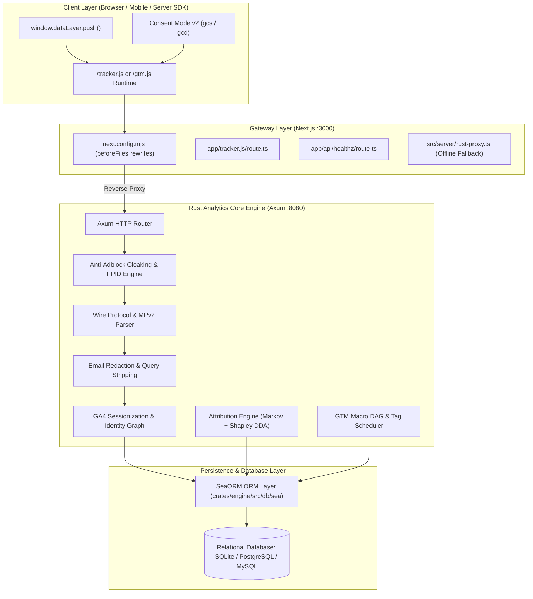
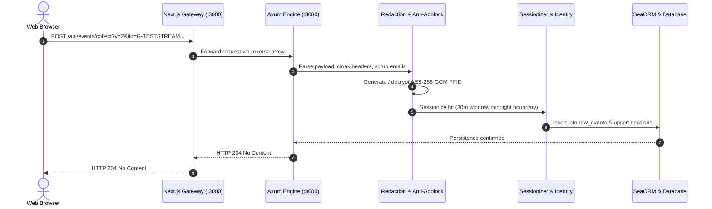
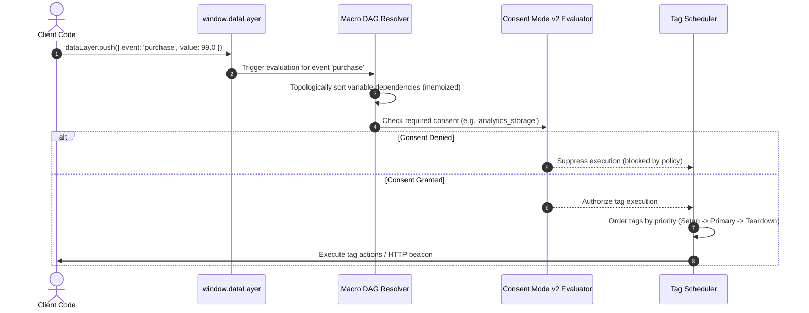
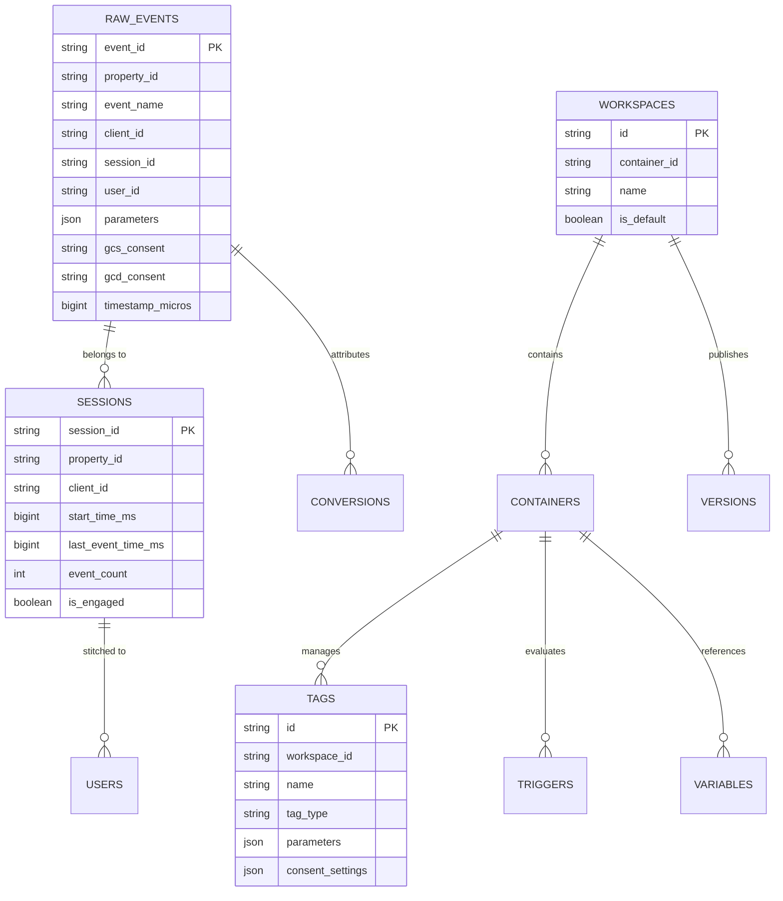

# ARCHITECTURE.md — System Architecture & Design

This document details the internal architecture, design principles, component interactions, and data pipelines of the **Open Source Analytics Kit (GTM & GA4 Full Parity)**.

---

## 1. High-Level Architecture Topology



---

## 2. Core Architectural Pillars

### Pillar 1: Separation of Presentation and Persistence
- **Next.js** handles **pure UI presentation** and **client tracking script distribution**.
- There are **no direct database queries** inside any Next.js API route or page component.
- All requests for analytics data, reports, real-time metrics, tags, triggers, and containers are proxied to the **Rust Engine** via `next.config.mjs` beforeFiles rewrites.

### Pillar 2: Rust Engine as the Single Source of Truth
- Built in Rust using **Axum** and **Tokio** for high-throughput, low-latency concurrent event ingestion.
- Database access is abstracted entirely via **SeaORM**, providing compile-time type safety, automated migration management, and dialect portability across **SQLite**, **PostgreSQL**, and **MySQL**.

### Pillar 3: First-Party Custom Endpoints
- Google's legacy endpoints are replaced with custom first-party paths:
  - `/api/events/collect` (replaces `/g/collect`)
  - `/api/events/batch` (replaces `/mp/collect`)
  - `/api/events/validate` (replaces `/debug/mp/collect`)
  - `/tracker.js` (replaces `/gtm.js`)
  - `/api/analytics/properties/:id/...` (replaces `/v1beta/properties/:id/...`)
  - `/api/tag-manager/workspaces/:id/...` (replaces `/api/v1/workspaces/:id/...`)
- Backward-compatible route aliases are maintained so existing Google Tag Manager and GA4 setups work without modification.

---

## 3. Data Flow Sequences

### 3.1 Event Ingestion Lifecycle



### 3.2 GTM Macro DAG & Tag Execution Sequence



---

## 4. SeaORM Database Schema

The entity definitions reside in `crates/engine/src/db/sea/`:



---

## 5. Anti-Adblock & Privacy Engineering

1. **First-Party Cloaking**:
   - Tracking scripts are served directly from the customer's first-party domain (`/tracker.js`).
   - Query strings and endpoints use neutral, first-party paths (`/api/events/collect`, `/_trk/collect`).
2. **First-Party Device ID (FPID)**:
   - Server-set, `HttpOnly`, `Secure`, `SameSite=Lax` cookies with AES-256-GCM encrypted tokens.
   - Prevents Safari ITP (Intelligent Tracking Prevention) 7-day or 24-hour cookie capping.
3. **Automated PII Redaction**:
   - Built-in regex filters detect and redact email addresses (`user@domain.com` -> `(redacted)`) across all incoming parameters before persistence.
   - Configurable list of stripped query parameters (e.g., `token`, `ssn`, `password`, `session_secret`).
4. **Consent Mode v2**:
   - Supports all 7 consent types: `ad_storage`, `analytics_storage`, `ad_user_data`, `ad_personalization`, `functionality_storage`, `personalization_storage`, `security_storage`.
   - Encodes and decodes Google-standard `gcs` (e.g. `G100`, `G111`) and `gcd` granular signal strings.

---

## 6. Multi-Platform Ingestion & Deployment Topology

### 6.1 Platform Ingestion Matrix
- **Web**: Dispatches wire payloads (`v=2&tid=...&cid=...&en=page_view`) through `/tracker.js` first-party script.
- **Android**: Dispatches hits with `_p=android&aid=<package_name>` via direct HTTP or Measurement Protocol v2 batch JSON.
- **iOS**: Dispatches hits with `_p=ios&bundle_id=<bundle_id>` via `URLSession` or Measurement Protocol v2 batch JSON.
- **Server**: Dispatches JSON hits with API secrets directly to `/api/events/batch`.

### 6.2 1-Command Self-Hosting Container Topology
```
[Host System]
  ├── docker-compose.yml
  ├── Service 'engine': Rust Axum (Port 8080) + SeaORM -> Volume /data/analytics.db
  └── Service 'web': Next.js Gateway (Port 3000) -> Proxies /api/* to engine:8080
```

