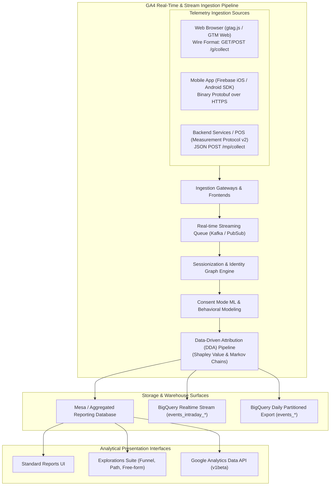
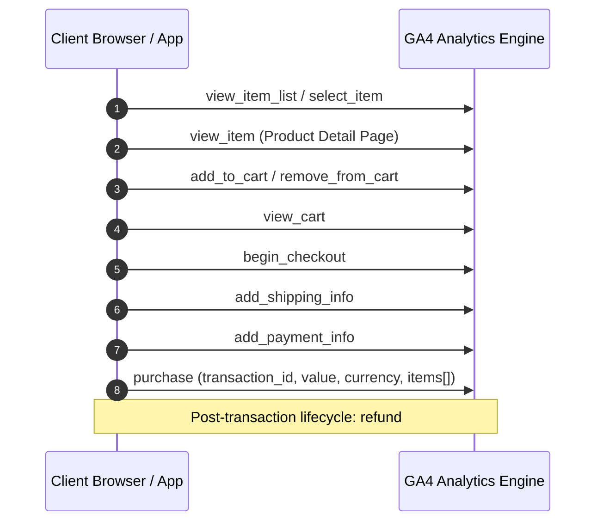
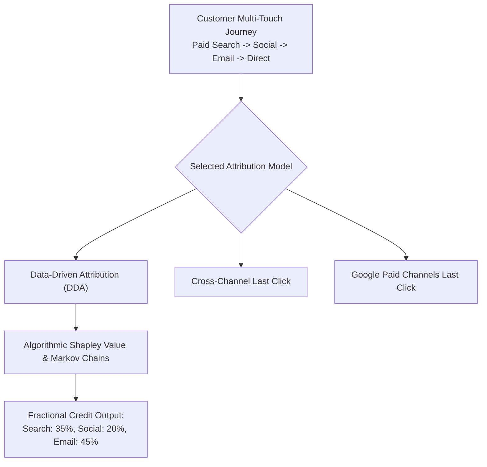
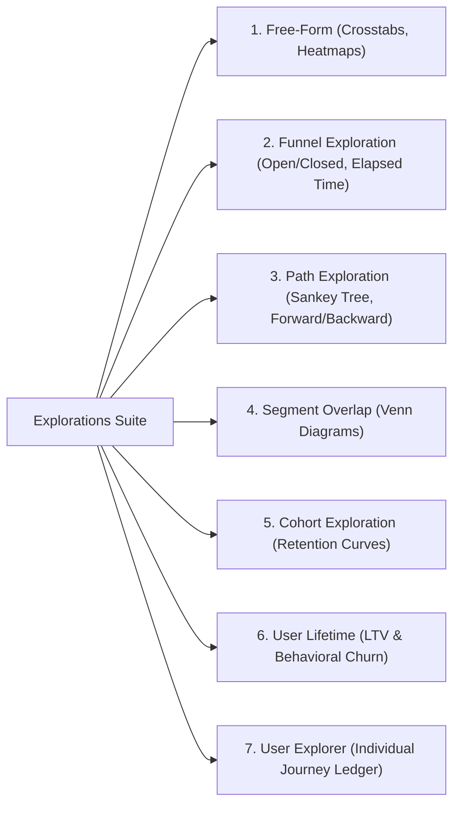
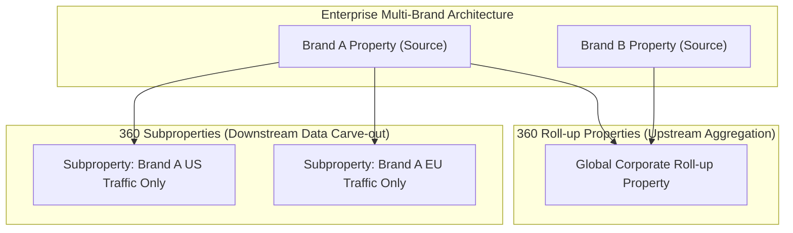
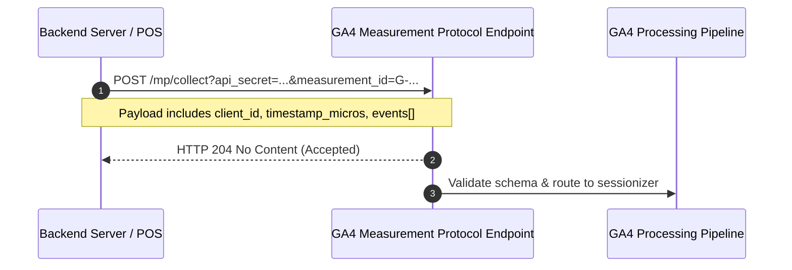

# Google Analytics 4 (GA4) Specification: Free vs. GA4 360 Enterprise
## A Comprehensive Functional, Technical, and Architectural Requirements Specification (SRS/FRS)

---

### Document Overview
This document serves as the exhaustive, production-grade functional and technical specification for Google Analytics 4 (GA4), detailing both the **Standard (Free)** and **360 (Enterprise)** offerings. It is written to provide an engineering blueprint for technical analysts, product managers, data engineers, and systems architects building, auditing, or implementing an enterprise-grade web and mobile analytics pipeline.

---

## Module 1: Event-Driven Architectural Paradigm & Processing Pipeline

### 1.1 The Event-Driven Ingestion Paradigm
Universal Analytics (UA) evaluated traffic through hit types (Pageviews, Events, Transactions, Social) grouped rigidly into sessions. Google Analytics 4 abandons hit types in favor of a unified, highly extensible **Event-Driven Architecture**:
* **Universal Event Primitive**: Every interaction is modeled as an Event with an `event_name` and an arbitrary key-value payload of `event_params`.
* **Disappearance of Hit-Type Constraints**: A pageview is simply `event_name: 'page_view'`. An ecommerce purchase is `event_name: 'purchase'`. User session initiation is `event_name: 'session_start'`.
* **Cross-Platform Schema Unification**: Native mobile apps (iOS/Android via Firebase) and web applications (`gtag.js` / Web GTM) ingest into the exact same canonical schema, eliminating multi-platform reporting divergence.



### 1.2 Processing SLAs & Enterprise Tiers
* **GA4 Standard (Free)**: Best-effort data processing. Intraday freshness typically takes between **24 to 48 hours** to fully process and settle attribution credit. Batch BigQuery exports are capped at **1,000,000 events per day**.
* **GA4 360 (Enterprise)**: Contractually backed by enterprise Service Level Agreements (SLAs). Guarantees data freshness within **1 to 4 hours**, scales daily BigQuery exports to **billions of events per day**, unlocks subproperties and roll-up properties, and expands metadata configuration caps by up to 5x.

---

## Module 2: Data Streams & Collection Ingestion Settings

A GA4 Property is a data container receiving telemetry from one or more **Data Streams**. A single property supports up to **50 data streams** (max 30 mobile streams).

### 2.1 Stream Types & Measurement Identifiers
1. **Web Data Stream**:
   * Evaluates browser client telemetry.
   * Identifier: **Measurement ID** formatted as `G-XXXXXXXXXX`.
   * Associated with a unique numeric `stream_id`.
2. **iOS Data Stream**:
   * Telemetry collected via Google Analytics for Firebase iOS SDK.
   * Identifier: Apple Bundle ID (e.g., `com.company.app`) + Firebase App ID.
3. **Android Data Stream**:
   * Telemetry collected via Google Analytics for Firebase Android SDK.
   * Identifier: Android Package Name (e.g., `com.company.app`) + Firebase App ID.

### 2.2 Ingestion Wire Protocol (`/g/collect` Endpoint)
Browser clients communicate with GA4 via HTTP GET or POST requests to `https://www.google-analytics.com/g/collect`. The wire format encodes telemetry as query parameters:

| Query Parameter | Technical Definition | Example Value |
| :--- | :--- | :--- |
| `v` | Protocol Version (always `2` for GA4) | `v=2` |
| `tid` | Target Measurement ID | `tid=G-ABC1234567` |
| `cid` | Client ID (`_ga` cookie value) | `cid=1892837192.1700000000` |
| `uid` | Authenticated User ID | `uid=USER_88291` |
| `_p` | Page token (unique integer for active pageview) | `_p=1829482` |
| `_s` | Hit sequence counter within page | `_s=1` |
| `sid` | Session ID (Unix epoch timestamp of session start)| `sid=1700001234` |
| `sct` | Session Count (lifetime incremental counter) | `sct=3` |
| `seg` | Session Engagement flag (`1` if engaged, `0` if not) | `seg=1` |
| `en` | Event Name | `en=page_view` |
| `ep.*` | String Event Parameter (`ep.key=value`) | `ep.article_author=JohnDoe` |
| `epn.*` | Numeric Event Parameter (`epn.key=value`) | `epn.reading_time=120` |
| `up.*` | String User Property (`up.key=value`) | `up.loyalty_tier=Platinum` |
| `upn.*` | Numeric User Property (`upn.key=value`) | `upn.lifetime_spend=1500.50` |
| `gcs` | Google Consent Status | `gcs=G111` |
| `gcd` | Google Consent Data (Consent Mode v2) | `gcd=13r3r3r3r5` |

#### Ingestion Batching & HTTP Payload Encoding
When client browsers buffer multiple events during high-frequency interactions (e.g., rapid clicks or visibility tracking), `gtag.js` dispatches an HTTP POST request to `/g/collect` with `Content-Type: text/plain;charset=UTF-8` containing newline-separated (`\n`) wire records:

```text
v=2&tid=G-ABC1234567&cid=1892837192.1700000000&_p=1829482&_s=1&sid=1700001234&sct=3&seg=1&en=page_view&dl=https%3A%2F%2Fbrand.com%2F
v=2&tid=G-ABC1234567&cid=1892837192.1700000000&_p=1829482&_s=2&sid=1700001234&sct=3&seg=1&en=scroll&epn.percent_scrolled=90
v=2&tid=G-ABC1234567&cid=1892837192.1700000000&_p=1829482&_s=3&sid=1700001234&sct=3&seg=1&en=click&ep.link_url=https%3A%2F%2Fpartner.com&ep.outbound=true
```

* **Batch Limits**: Up to **50 events per batch** or **16 KB payload cap** per POST request.

### 2.3 Enhanced Measurement Configuration (Web Streams)
Enhanced Measurement automatically instruments browser interactions without requiring code modifications:

1. **Page Views (`page_view`)**:
   * Trigger: Dispatched on document initialization.
   * SPA Support: Intercepts `history.pushState`, `history.replaceState`, and `popstate`.
   * Parameters: `page_location` (full URL), `page_referrer` (document.referrer), `page_title` (document.title).
2. **Scrolls (`scroll`)**:
   * Trigger: Fires once per page when vertical scroll depth crosses **90%**.
   * Parameters: `percent_scrolled: 90`.
3. **Outbound Clicks (`click`)**:
   * Trigger: Fires on anchor (`<a>`) clicks pointing outside the current hostname.
   * Parameters: `link_url`, `link_domain`, `link_classes`, `link_id`, `outbound: true`.
4. **Site Search (`view_search_results`)**:
   * Trigger: Fires if URL query parameters contain search keys (`q`, `s`, `search`, `query`, `keyword`).
   * Parameters: `search_term` (extracted query string).
5. **Video Engagement**:
   * Trigger: Intercepts YouTube iframe players with JS API enabled (`enablejsapi=1`).
   * Events: `video_start`, `video_progress` (10%, 25%, 50%, 75%), `video_complete`.
   * Parameters: `video_provider: 'youtube'`, `video_title`, `video_url`, `video_duration`, `video_current_time`, `video_percent`, `visible`.
6. **File Downloads (`file_download`)**:
   * Trigger: Fires on clicks matching extensions: `pdf`, `zip`, `rar`, `docx`, `xlsx`, `pptx`, `txt`, `csv`, `exe`, `mp3`, `mp4`.
   * Parameters: `file_name`, `file_extension`, `link_url`, `link_text`.
7. **Form Interactions**:
   * `form_start`: First user interaction with form field in a session.
   * `form_submit`: Dispatched on successful form submit.
   * Parameters: `form_id`, `form_name`, `form_destination`, `form_submit_text`.

### 2.4 Advanced Stream Configuration Rules
* **Cross-Domain Linking**: Appends `_gl=1*...` to links across designated domains to share `_ga` client IDs without third-party cookies.
* **Internal Traffic Definition**: Matches IPv4, IPv6, and CIDR blocks to tag incoming traffic with `traffic_type = 'internal'`.
* **Referral Exclusions**: Strips payment processors and login portals (PayPal, Stripe) from overwriting campaign attribution.
* **Session Inactivity Timeout**: Configurable from **5 minutes to 7 hours 55 minutes** (default: 30 minutes).
* **Engaged Session Timer**: Configurable to **10, 20, 30, or 60 seconds** (default: 10 seconds).
* **Data Redaction**:
  * Client-side regex engine replaces email addresses in URLs with `(redacted)`.
  * Designated URL query keys (e.g., `token`, `ssn`) are purged prior to transmission.
* **User-Provided Data Collection (Enhanced Conversions)**: Ingests SHA-256 hashed customer identifiers (email, phone, address) for Google Ads conversion modeling.

---

## Module 3: Event Taxonomy & Schema Specification

### 3.1 Automatically Collected Events

| Event Name | Platform | Triggering Condition | Parameters Emitted |
| :--- | :--- | :--- | :--- |
| `first_visit` | Web | Initial browser visit to property | `page_location`, `page_referrer` |
| `first_open` | Mobile | Initial app launch post-install | `previous_app_version`, `install_store` |
| `session_start` | Web / Mobile | First hit of a new session after inactivity | `ga_session_id`, `ga_session_number` |
| `user_engagement` | Web / Mobile | Dispatched periodically while tab/app is focused | `engagement_time_msec` |
| `app_remove` | Mobile (Android)| App package uninstalled from device | `app_version` |
| `app_store_refund` | Mobile (iOS) | In-app purchase refund via App Store | `currency`, `value` |
| `app_store_subscription_cancel` | Mobile | User cancels recurring subscription | `subscription_id` |
| `app_store_subscription_convert`| Mobile | Free trial converts to paid tier | `subscription_id` |
| `app_store_subscription_renew` | Mobile | Subscription auto-renews | `subscription_id` |
| `in_app_purchase` | Mobile | In-app purchase via Google Play / App Store | `product_id`, `price`, `currency`, `quantity` |
| `screen_view` | Mobile | User navigates to a new view/screen | `firebase_screen`, `firebase_screen_class` |

### 3.2 Standard Ecommerce Funnel Taxonomy (14 Events)



1. `view_item_list`: User views a catalog, category grid, or search results.
2. `select_item`: User clicks a product from a list.
3. `view_item`: User views a Product Detail Page (PDP).
4. `view_promotion`: User views an internal banner or promo card.
5. `select_promotion`: User clicks an internal promotional banner.
6. `add_to_cart`: User adds an item to shopping basket.
7. `remove_from_cart`: User removes an item from shopping basket.
8. `view_cart`: User navigates to the shopping cart page.
9. `begin_checkout`: User initiates the checkout flow.
10. `add_shipping_info`: User selects shipping method.
11. `add_payment_info`: User submits payment credentials.
12. `purchase`: User completes transaction. **Mandatory**: `transaction_id`, `value`, `currency`, `items`.
13. `refund`: Full or partial transaction refund.
14. `add_to_wishlist`: User saves an item to wishlist.

#### Complete Standard Items Array Schema
The `items` array carries item-level structures across all ecommerce events:

```json
{
  "event": "purchase",
  "params": {
    "transaction_id": "ORD-2026-99881",
    "value": 184.99,
    "currency": "USD",
    "tax": 15.00,
    "shipping": 10.00,
    "coupon": "WINTER_PROMO",
    "items": [
      {
        "item_id": "SKU_PRO_100",
        "item_name": "Ultra Running Shoe",
        "affiliation": "Flagship NYC Store",
        "coupon": "PROMO_10",
        "currency": "USD",
        "discount": 10.00,
        "index": 1,
        "item_brand": "FleetFeet",
        "item_category": "Apparel",
        "item_category2": "Footwear",
        "item_category3": "Running",
        "item_category4": "Men",
        "item_category5": "Trail",
        "item_list_id": "category_grid_shoes",
        "item_list_name": "Men Trail Running",
        "item_variant": "Midnight Blue / Size 10.5",
        "location_id": "LOC_NYC_01",
        "price": 159.99,
        "quantity": 1
      }
    ]
  }
}
```

### 3.3 Recommended Vertical Events Catalog (Games, Lead Gen, Online Sales)

#### 1. Games (Gaming Vertical)
* `earn_virtual_currency`: `virtual_currency_name` (string), `value` (number).
* `spend_virtual_currency`: `virtual_currency_name` (string), `value` (number), `item_name` (string).
* `level_start`: `level_name` (string).
* `level_end`: `level_name` (string), `success` (boolean).
* `level_up`: `level` (integer), `character` (string).
* `post_score`: `score` (integer), `level` (integer), `character` (string).
* `unlock_achievement`: `achievement_id` (string).
* `tutorial_begin` / `tutorial_complete`: Tracks onboarding progression.

#### 2. Lead Generation & Enterprise B2B Pipeline
* `generate_lead`: `currency` (string), `value` (number).
* `qualify_lead`: Lead meets qualification criteria.
* `disqualify_lead`: Lead rejected.
* `working_lead`: Sales representative initiates contact.
* `close_convert_lead`: Deal won and closed.
* `close_unconvert_lead`: Deal lost.

### 3.4 Custom Event Naming Rules & Constraints
* **Syntax**: Alphanumeric characters and underscores only (`[a-zA-Z0-9_]`). Must begin with an alphabetic character. Case-sensitive.
* **Character Length Limit**: Maximum **40 characters** for event names.
* **Reserved Prefixes**: Cannot begin with `_`, `ga_`, `google_`, or `firebase_`.
* **Mobile App Quota**: Maximum **500 distinctly named events** per mobile app instance (not enforced on Web streams).

---

## Module 4: Custom Dimensions, Metrics & Metadata Registry

### 4.1 Custom Dimensions Specification

| Scope | Technical Definition | GA4 Standard Limit | GA4 360 Enterprise Limit |
| :--- | :--- | :--- | :--- |
| **Event-Scoped Dimension** | Parameters evaluated in context of individual event | **50 per property** | **125 per property** |
| **User-Scoped Dimension** | Persistent attributes attached to user profile | **25 per property** | **100 per property** |
| **Item-Scoped Dimension** | Custom attributes attached to products in `items[]` | **10 per property** | **25 per property** |

### 4.2 Custom Metrics Specification
* **Scope**: Event-scoped numerical aggregations.
* **Limits**:
  * *Standard (Free)*: **50** custom metrics per property.
  * *360 Enterprise*: **125** custom metrics per property.
* **Measurement Units**: Standard (Numeric/Float), Currencies (USD, EUR, GBP, JPY, etc.), Distance (Feet, Miles, Meters, Kilometers), Time (Milliseconds, Seconds, Minutes, Hours).

### 4.3 Calculated Metrics Specification
Calculated metrics allow mathematical manipulation of existing standard or custom metrics:
* **Formula Syntax**: Supports arithmetic operators `+`, `-`, `*`, `/`, and grouping parentheses `()`.
  * *Example*: `Cart-to-View Rate = add_to_cart / view_item`
  * *Example*: `Net Margin = (purchase_revenue - total_cost) / purchase_revenue`
* **Formatting Types**: Float (Standard), Currency, Distance, Time, Percentage.
* **Limits**:
  * *Standard (Free)*: **5** calculated metrics per property.
  * *360 Enterprise*: **50** calculated metrics per property.

### 4.4 Custom Channel Groups
Custom Channel Groups allow rule-based reclassification of marketing channels and traffic dimensions:
* **Rule Logic**: Evaluates `Source`, `Medium`, `Source platform`, `Campaign name`, and `Default channel group` using regex, contains, equals, etc.
* **Limits**:
  * *Standard (Free)*: **2** custom channel groups per property (up to 50 channels each).
  * *360 Enterprise*: **5** custom channel groups per property (up to 50 channels each).

---

## Module 5: Key Events & Attribution Modeling

### 5.1 Key Events Configuration
In 2024, Google rebranded in-platform GA4 conversions to **Key Events** to disambiguate GA4 measurement from Google Ads conversions.
* **Counting Methods**:
  * **Once per event**: Increments the metric every time the event fires (standard for ecommerce purchases).
  * **Once per session**: Increments the metric at most once per session regardless of frequency (standard for lead generation).
* **Property Limits**:
  * *Standard (Free)*: **30** key events per property.
  * *360 Enterprise*: **50** key events per property.

### 5.2 Attribution Modeling Mathematics



#### 1. Data-Driven Attribution (DDA) Mathematics
GA4's DDA combines two mathematical frameworks:
* **The Shapley Value Formulation**:
  From cooperative game theory, the marginal contribution of channel $i$ across all possible subsets of channels $S \subseteq N \setminus \{i\}$ is defined as:
  $$\phi_i(v) = \sum_{S \subseteq N \setminus \{i\}} \frac{|S|!(|N| - |S| - 1)!}{|N|!} \left[ v(S \cup \{i\}) - v(S) \right]$$
  Where $N$ is the set of all marketing touchpoints, and $v(S)$ represents the conversion probability of customer paths containing only touchpoints in $S$.
* **Markov Chain Removal Effect Formulation**:
  Models customer journeys as a state transition matrix $T$, where $T_{u,v}$ is the transition probability from state $u$ to state $v$.
  The baseline conversion probability across all valid paths is:
  $$P(\text{Conversion}) = \sum_{p \in \text{Paths}} \prod_{(u,v) \in p} T_{u,v}$$
  The **Removal Effect** of channel $C_i$ simulates the drop in overall conversions when channel $C_i$ is completely eliminated:
  $$\text{RemovalEffect}(C_i) = \frac{P(\text{Conversion}) - P(\text{Conversion} \setminus C_i)}{P(\text{Conversion})}$$
  Attribution weight is normalized across all channels:
  $$\text{Weight}(C_i) = \frac{\text{RemovalEffect}(C_i)}{\sum_j \text{RemovalEffect}(C_j)}$$

#### 2. Cross-Channel Last Click
Direct traffic is ignored; 100% of conversion credit is assigned to the last non-direct marketing channel.

#### 3. Google Paid Channels Last Click (Ads-Preferred)
Attributes 100% of conversion credit to the last Google Ads touchpoint encountered in the journey; falls back to cross-channel last click if no Google Ads click exists.

### 5.3 Attribution Lookback Windows
* **Acquisition Key Events (`first_open`, `first_visit`)**: Configurable to **30 days** (default) or **7 days**.
* **All Other Key Events**: Configurable to **90 days** (default), **60 days**, or **30 days**.

---

## Module 6: Standard Reporting & Explorations Suite

### 6.1 Standard Reports Subsystem
* **Realtime Report**: Visualizes traffic over the preceding 30-minute rolling window. Supports "View user snapshot" to inspect individual live user sessions.
* **Life Cycle Collection**:
  * *Acquisition*: User acquisition (first-touch) vs. Traffic acquisition (session-touch).
  * *Engagement*: Events, Key Events, Pages and Screens, Landing page.
  * *Monetization*: Ecommerce purchases, In-app purchases, Publisher ads.
  * *Retention*: New vs. Returning users, Cohort retention curves.
* **User Collection**: Demographics (Country, City, Gender, Age, Interests) and Tech (Browser, OS, Device category, Screen resolution).

### 6.2 Explorations Framework (Advanced Analytics)



1. **Free-Form Exploration**: Cross-tabulation pivot tables. Supports nested dimensions, custom metric columns, heatmaps, bar charts, and scatter plots.
2. **Funnel Exploration**: Evaluates sequential conversion drop-offs. Supports **Open Funnels** vs. **Closed Funnels**, elapsed time between steps, and next action tracking.
3. **Path Exploration**: Tree-graph (Sankey) visualization. Supports forward pathing (from starting node) and backward pathing (from conversion goal).
4. **Segment Overlap**: Venn-diagram visualization comparing up to 3 segments to isolate intersecting user bases.
5. **Cohort Exploration**: Groups users by acquisition date or event condition, measuring retention, engagement, and conversion decay over daily, weekly, or monthly cohorts.
6. **User Lifetime**: Analyzes lifetime value (LTV) and revenue contributions across historical cohorts.
7. **User Explorer**: Drills down into individual pseudonymous client journeys (`user_pseudo_id`), displaying an exact chronological ledger of every event fired by that user.

### 6.3 Sampling, Cardinality & Data Thresholding
* **Sampling Ceilings**:
  * *Standard (Free)*: **10 Million events** per exploration query.
  * *360 Enterprise*: **1 Billion events** per exploration query.
  * *Unsampled Explorations (360 Only)*: Allows exporting complete unsampled datasets regardless of volume.
* **High Cardinality & The `(other)` Row**: When a dimension contains excessive unique values, GA4 aggregates rows beyond daily limits into an `(other)` row.
  * *Expanded Data Sets (360 Only)*: Allows designating up to 100 high-cardinality dimensions to be pre-aggregated, permanently eliminating `(other)` rows.
* **Data Thresholding**: Triggered when Google Signals is enabled or when user volume in a reporting row is low to prevent identity reconstruction.

---

## Module 7: Identity Spaces & Sessionization Engine

### 7.1 The Four Identity Spaces
GA4 resolves user journeys by reconciling across four identity tiers:
1. **User-ID**: Explicit authenticated customer identifier passed via `gtag('set', 'user_id', 'UID_12345')`. Enables cross-device journey stitching.
2. **Google Signals**: Aggregated, deduplicated data from Google users who have turned on Ads Personalization. Enables cross-device reporting and demographic data enrichment.
3. **Device ID**: Client-side pseudonymous identifiers (`client_id` via `_ga` cookie on Web; Firebase `app_instance_id` on Mobile).
4. **Modeled Data**: Bayesian machine learning models estimating unconsented user traffic and conversions when Consent Mode is active.

### 7.2 Reporting Identity Configurations
* **Blended**: Evaluates identity in order: `User-ID` $\rightarrow$ `Google Signals` $\rightarrow$ `Device ID` $\rightarrow$ `Modeled`.
* **Observed**: Evaluates `User-ID` $\rightarrow$ `Google Signals` $\rightarrow$ `Device ID`.
* **Device-Based**: Uses `Device ID` exclusively (**eliminates Google Signals data thresholding**).

### 7.3 Sessionization Mechanics & Engagement Algorithms
* **Session ID (`ga_session_id`)**: A Unix timestamp epoch generated on the client when a user initiates a session. Transmitted on every hit.
* **Session Number (`ga_session_number`)**: An incremental counter tracking how many lifetime sessions the specific user has logged.
* **Engaged Session Qualification**: A session is classified as an **Engaged Session** if it meets at least one of three criteria:
  1. Lasts longer than the configured engagement threshold (default: 10 seconds).
  2. Includes **2 or more** page/screen views.
  3. Triggers at least **1 key event**.
* **Engagement Rate**: Calculated as $\text{Engagement Rate} = \frac{\text{Engaged Sessions}}{\text{Total Sessions}}$.
* **Bounce Rate**: Mathematically defined as $1 - \text{Engagement Rate}$.

#### Sessionization State Machine Algorithm (Reference Implementation)
```typescript
export interface SessionState {
  clientId: string;
  sessionId: number;
  sessionNumber: number;
  lastEventTimestamp: number;
  engagementTimeMs: number;
  pageViewCount: number;
  hasKeyEvent: boolean;
  isEngaged: boolean;
}

export function processHitSession(
  hit: { timestamp: number; eventName: string; isKeyEvent: boolean; engagementTimeMs?: number },
  currentSession: SessionState | null,
  timeoutMinutes: number = 30,
  engagedThresholdSec: number = 10
): { session: SessionState; isNewSession: boolean } {
  const timeoutMs = timeoutMinutes * 60 * 1000;
  const isExpired = !currentSession || (hit.timestamp - currentSession.lastEventTimestamp) > timeoutMs;

  let session: SessionState;
  let isNewSession = false;

  if (isExpired) {
    isNewSession = true;
    session = {
      clientId: currentSession?.clientId || 'ANON',
      sessionId: Math.floor(hit.timestamp / 1000),
      sessionNumber: (currentSession?.sessionNumber || 0) + 1,
      lastEventTimestamp: hit.timestamp,
      engagementTimeMs: hit.engagementTimeMs || 0,
      pageViewCount: hit.eventName === 'page_view' ? 1 : 0,
      hasKeyEvent: hit.isKeyEvent,
      isEngaged: false
    };
  } else {
    session = { ...currentSession };
    session.lastEventTimestamp = hit.timestamp;
    session.engagementTimeMs += (hit.engagementTimeMs || 0);
    if (hit.eventName === 'page_view') session.pageViewCount += 1;
    if (hit.isKeyEvent) session.hasKeyEvent = true;
  }

  // Evaluate engaged status
  if (!session.isEngaged) {
    if (session.engagementTimeMs >= (engagedThresholdSec * 1000) ||
        session.pageViewCount >= 2 ||
        session.hasKeyEvent) {
      session.isEngaged = true;
    }
  }

  return { session, isNewSession };
}
```

---

## Module 8: Enterprise Architecture: Subproperties & Roll-up Properties (GA4 360 Only)



### 8.1 Subproperties
Subproperties allow carving out a segmented subset of data from a parent source property.
* **Architecture**: Data is routed downstream from the source property after ingestion.
* **Use Cases**: Regional data isolation (e.g., granting an EMEA team access exclusively to European data without seeing US revenue), franchise tracking, or isolating sensitive transactional funnels.
* **Independent Governance**: Subproperties maintain independent:
  * User access controls and permissions.
  * Data retention durations (e.g., 50 months on subproperty vs 14 on source).
  * Custom dimension registrations and Key Events.
  * Dedicated BigQuery exports.
* **Limit**: Up to **400 subproperties** per source property.

### 8.2 Roll-up Properties
Roll-up properties aggregate telemetry from multiple source properties into a unified global reporting container.
* **Architecture**: Combines disparate brand, regional, or app properties into a single macroscopic property.
* **Global Deduplication**: Users visiting multiple source properties are deduplicated at the roll-up level if they share a common `user_id` or `client_id`.
* **Limit**: Up to **200 source properties** can be mapped into a single roll-up property.

---

## Module 9: Audiences, Predictive Intelligence & Audience Triggers

### 9.1 Custom Audience Builder
* **Evaluation Scopes**:
  * *Within same event*: Conditions must be met within a single event payload.
  * *Within same session*: Conditions must occur across the span of one session.
  * *Across all sessions*: Lifetime user profile evaluation.
* **Dynamic Evaluation**: Users enter and exit audiences dynamically as their behavioral patterns evolve.
* **Membership Duration**: Configurable from **1 to 540 days** (or set to Maximum / Reset on new activity).
* **Audience Limits**:
  * *Standard (Free)*: Up to **100** audiences per property.
  * *360 Enterprise*: Up to **400** audiences per property.

### 9.2 Predictive Intelligence & Machine Learning
GA4 continuously runs structured machine learning models over user datasets that meet required transaction volumes:
* **Prerequisites**: A minimum of 1,000 positive converting users and 1,000 non-converting users over a rolling 7-day period.
* **Predictive Metrics**:
  * `Purchase Probability`: Likelihood that a user who was active in the last 28 days will make a purchase in the next 7 days.
  * `Churn Probability`: Likelihood that a user who was active in the last 7 days will not be active in the subsequent 7 days.
  * `Predicted 28-day Revenue`: Revenue expected from all purchases over the next 28 days from an active user.

### 9.3 Audience Triggers
Audience Triggers generate and dispatch an entirely new synthetic event when a user satisfies the conditions of an audience definition:
* **Use Case**: Fire a `qualified_lead_scored` or `high_value_churn_risk` event the instant a user enters that audience, allowing it to be marked as a Key Event or exported to Google Ads for immediate remarketing.
* **Limit**: Up to **20 audience triggers** per property.

---

## Module 10: Data Governance, Privacy & Compliance Engine

### 10.1 Consent Mode v2 Architecture
Consent Mode v2 integrates regulatory compliance directly into data ingestion:
* **Consent Signals**: `ad_storage`, `analytics_storage`, `ad_user_data`, `ad_personalization`.
* **Behavioral Modeling**: Fills measurement blind spots. If users decline analytics storage, GA4's machine-learning engine trains on consented user patterns and ambient device metadata (browser, OS, time, country) to probabilistically model sessions, pageviews, and key events.

### 10.2 Data Redaction & Privacy Guardrails
* **Client-Side Email Scrubbing**: Automatically detects email strings (`user@domain.com`) inside query parameters and pathnames, replacing them with `(redacted)`.
* **Granular Location & Device Data Toggle**: Allows disabling the collection of detailed geographic data (city, latitude/longitude) and device metadata (screen resolution, device model) on a per-country basis.

### 10.3 Data Deletion Engine
Provides three compliance mechanisms for regulatory requests (GDPR Article 17, CCPA):
1. **Delete All Data for a User**: Programmatically scrub all historical records matching a specific `user_id` or `client_id` via the User Deletion API.
2. **Parameter Deletion**: Erases specific custom parameters across all events within a designated historical date range (useful if PII was accidentally logged into a custom parameter).
3. **Property Deletion**: Complete administrative decommissioning of property records.

### 10.4 Data Retention Policies
Governs the maximum retention lifespan of event-level and user-level data stored in the exploration analytics database:
* **Standard (Free) GA4**: Options: **2 months** or **14 months** maximum.
* **GA4 360 Enterprise**: Options: **2 months**, **14 months**, **26 months**, **38 months**, or **50 months**.

---

## Module 11: Measurement Protocol v2 (Developer Specification)



### 11.1 Endpoints
* **Production Endpoint**: `POST https://www.google-analytics.com/mp/collect`
* **Validation / Debug Endpoint**: `POST https://www.google-analytics.com/debug/mp/collect`
  *(Returns a JSON validation report displaying schema errors, parameter warnings, and parsing diagnostics without storing data).*

### 11.2 Required Query Parameters
* `api_secret`: A secure token generated in GA4 Admin $\rightarrow$ Data Streams $\rightarrow$ Measurement Protocol API Secrets.
* `measurement_id`: Target web stream ID (`G-XXXXXXXXXX`).
* `firebase_app_id`: Target mobile stream ID (for Firebase mobile apps).

### 11.3 JSON Request Payload Specification

```json
{
  "client_id": "1892837192.1700000000",
  "user_id": "UID_987654",
  "timestamp_micros": 1700000000000000,
  "non_personalized_ads": false,
  "user_properties": {
    "loyalty_tier": {
      "value": "Platinum"
    }
  },
  "consent": {
    "ad_user_data": "GRANTED",
    "ad_personalization": "GRANTED"
  },
  "events": [
    {
      "name": "offline_purchase",
      "params": {
        "transaction_id": "POS_445566",
        "currency": "USD",
        "value": 249.50,
        "engagement_time_msec": 100,
        "items": [
          {
            "item_id": "SKU_OFFLINE_01",
            "item_name": "Premium Leather Jacket",
            "price": 249.50,
            "quantity": 1
          }
        ]
      }
    }
  ]
}
```

### 11.4 Key Field Rules & Limits
* `client_id`: Required string (if mobile `app_instance_id` is omitted). Must match client cookie value to stitch with web sessions.
* `timestamp_micros`: Microsecond timestamp epoch. Allows backfilling offline transactions up to **72 hours (3 calendar days)** in the past.
* `events`: Array containing up to **25 events** per HTTP request. Maximum payload size: **130 KB**.

### 11.5 Debug Validation API Response Schema (`/debug/mp/collect`)
When sending hits to the validation endpoint, GA4 returns a diagnostic JSON object identifying parse errors:

```json
{
  "validationMessages": [
    {
      "fieldPath": "events[0].params.items[0].price",
      "description": "Item price must be a numeric value.",
      "validationCode": "VALUE_INVALID"
    },
    {
      "fieldPath": "events[0].name",
      "description": "Event name cannot exceed 40 characters.",
      "validationCode": "NAME_TOO_LONG"
    }
  ]
}
```

---

## Module 12: BigQuery Export Pipeline & Data Warehouse Architecture

### 12.1 Export Modes & Limits
1. **Daily (Batch) Export**: Appends an immutable partitioned table `events_YYYYMMDD` once per day.
   * *Standard (Free) Limit*: Capped at **1 Million events per day**. Surpassing 1M events causes the batch export to truncate.
   * *360 Enterprise Limit*: Expanded to **billions of events per day** (configurable up to 20 billion).
2. **Streaming Export**: Ingests events in real-time into `events_intraday_YYYYMMDD` tables with latency under 10 seconds.
   * Available on both Standard and 360 tiers (standard BigQuery streaming ingestion pricing applies).
3. **Fresh Daily Intraday (GA4 360 Only)**: Continuous batch refresh of intraday tables providing consistent intraday reconciliation.
4. **User Data Export**: Exports user lifetime state tables: `pseudonymous_users_YYYYMMDD` and `users_YYYYMMDD`.

### 12.2 BigQuery Record Schema Specification

| Field Name | Type | Mode | Technical Description |
| :--- | :--- | :--- | :--- |
| `event_date` | STRING | NULLABLE | Date of event (`YYYYMMDD`) |
| `event_timestamp` | INTEGER | NULLABLE | Microsecond UTC timestamp of event |
| `event_name` | STRING | NULLABLE | Name of the event (e.g., `'page_view'`, `'purchase'`) |
| `event_params` | RECORD | REPEATED | Key-value dictionary containing event parameters |
| `event_params.key` | STRING | NULLABLE | Parameter name string |
| `event_params.value.string_value` | STRING | NULLABLE | Populated if parameter value is string |
| `event_params.value.int_value` | INTEGER | NULLABLE | Populated if parameter value is integer |
| `event_params.value.float_value` | FLOAT | NULLABLE | Populated if parameter value is float |
| `event_params.value.double_value` | FLOAT | NULLABLE | Populated if parameter value is double |
| `event_previous_timestamp` | INTEGER | NULLABLE | Previous event microsecond timestamp |
| `event_value_in_usd` | FLOAT | NULLABLE | Normalized currency value converted to USD |
| `event_bundle_sequence_id` | INTEGER | NULLABLE | Monotonic bundle identifier from client upload |
| `event_server_timestamp_offset`| INTEGER | NULLABLE | Offset between device time and ingestion server |
| `user_id` | STRING | NULLABLE | Authenticated user ID string |
| `user_pseudo_id` | STRING | NULLABLE | Client-side cookie ID (`_ga`) or Firebase app ID |
| `privacy_info` | RECORD | NULLABLE | Contains `analytics_storage`, `ads_storage` consent flags|
| `user_properties` | RECORD | REPEATED | Repeated key-value struct of user-level properties |
| `user_first_touch_timestamp` | INTEGER | NULLABLE | Microsecond timestamp of user's first visit |
| `user_ltv` | RECORD | NULLABLE | Lifetime value struct: `revenue`, `currency` |
| `device` | RECORD | NULLABLE | `category`, `mobile_brand_name`, `operating_system`, `web_info.browser` |
| `geo` | RECORD | NULLABLE | `continent`, `sub_continent`, `country`, `region`, `city`, `metro` |
| `app_info` | RECORD | NULLABLE | `id`, `version`, `install_store`, `firebase_app_id` |
| `traffic_source` | RECORD | NULLABLE | `name` (campaign), `medium`, `source` |
| `collected_traffic_source` | RECORD | NULLABLE | Unmodified campaign source/medium captured on hit |
| `stream_id` | STRING | NULLABLE | Numeric data stream identifier |
| `platform` | STRING | NULLABLE | `'WEB'`, `'IOS'`, or `'ANDROID'` |
| `ecommerce` | RECORD | NULLABLE | `total_item_quantity`, `purchase_revenue`, `refund_value`, `shipping_value`, `tax_value`, `transaction_id` |
| `items` | RECORD | REPEATED | Array of item structs (`item_id`, `item_name`, `price`, `quantity`, etc.) |

#### Production SQL Query Pattern: Unnesting Parameters and Items
```sql
SELECT
  PARSE_DATE('%Y%m%d', event_date) AS event_date,
  TIMESTAMP_MICROS(event_timestamp) AS event_timestamp,
  event_name,
  user_pseudo_id,
  user_id,
  -- Extract scalar event parameter
  (SELECT value.string_value FROM UNNEST(event_params) WHERE key = 'page_location') AS page_location,
  (SELECT value.int_value FROM UNNEST(event_params) WHERE key = 'ga_session_id') AS session_id,
  -- Extract ecommerce metrics
  ecommerce.transaction_id,
  ecommerce.purchase_revenue,
  -- Unnest items array
  item.item_id,
  item.item_name,
  item.price,
  item.quantity
FROM
  `your-project.analytics_123456789.events_*`,
  UNNEST(items) AS item
WHERE
  _TABLE_SUFFIX BETWEEN '20261101' AND '20261103'
  AND event_name = 'purchase';
```

### 12.3 Complete BigQuery Table DDL Specification
Data engineers building an open-source warehouse schema can deploy the identical GA4 table structure using standard BigQuery SQL DDL:

```sql
CREATE TABLE IF NOT EXISTS `analytics_export.events_partitioned` (
  event_date STRING,
  event_timestamp INT64,
  event_name STRING,
  event_params ARRAY<STRUCT<
    key STRING,
    value STRUCT<
      string_value STRING,
      int_value INT64,
      float_value FLOAT64,
      double_value FLOAT64
    >
  >>,
  event_previous_timestamp INT64,
  event_value_in_usd FLOAT64,
  event_bundle_sequence_id INT64,
  event_server_timestamp_offset INT64,
  user_id STRING,
  user_pseudo_id STRING,
  privacy_info STRUCT<
    analytics_storage INT64,
    ads_storage INT64,
    uses_transient_token STRING
  >,
  user_properties ARRAY<STRUCT<
    key STRING,
    value STRUCT<
      string_value STRING,
      int_value INT64,
      float_value FLOAT64,
      double_value FLOAT64,
      set_timestamp_micros INT64
    >
  >>,
  user_first_touch_timestamp INT64,
  user_ltv STRUCT<
    revenue FLOAT64,
    currency STRING
  >,
  device STRUCT<
    category STRING,
    mobile_brand_name STRING,
    mobile_model_name STRING,
    mobile_marketing_name STRING,
    mobile_os_hardware_model STRING,
    operating_system STRING,
    operating_system_version STRING,
    vendor_id STRING,
    advertising_id STRING,
    language STRING,
    is_limited_ad_tracking STRING,
    time_zone_offset_seconds INT64,
    browser STRING,
    browser_version STRING,
    web_info STRUCT<
      browser STRING,
      browser_version STRING,
      hostname STRING
    >
  >,
  geo STRUCT<
    continent STRING,
    sub_continent STRING,
    country STRING,
    region STRING,
    city STRING,
    metro STRING
  >,
  app_info STRUCT<
    id STRING,
    version STRING,
    install_store STRING,
    firebase_app_id STRING,
    install_source STRING
  >,
  traffic_source STRUCT<
    name STRING,
    medium STRING,
    source STRING
  >,
  collected_traffic_source STRUCT<
    manual_campaign_id STRING,
    manual_campaign_name STRING,
    manual_source STRING,
    manual_medium STRING,
    manual_term STRING,
    manual_content STRING,
    gclid STRING,
    dclid STRING,
    srsltid STRING
  >,
  stream_id STRING,
  platform STRING,
  event_dimensions STRUCT<
    hostname STRING
  >,
  ecommerce STRUCT<
    total_item_quantity INT64,
    purchase_revenue_in_usd FLOAT64,
    purchase_revenue FLOAT64,
    refund_value_in_usd FLOAT64,
    refund_value FLOAT64,
    shipping_value_in_usd FLOAT64,
    shipping_value FLOAT64,
    tax_value_in_usd FLOAT64,
    tax_value FLOAT64,
    unique_items INT64,
    transaction_id STRING
  >,
  items ARRAY<STRUCT<
    item_id STRING,
    item_name STRING,
    item_brand STRING,
    item_category STRING,
    item_category2 STRING,
    item_category3 STRING,
    item_category4 STRING,
    item_category5 STRING,
    item_variant STRING,
    price FLOAT64,
    quantity INT64,
    item_revenue FLOAT64,
    item_revenue_in_usd FLOAT64,
    coupon STRING,
    affiliation STRING,
    location_id STRING,
    item_list_id STRING,
    item_list_name STRING,
    item_list_index STRING,
    promotion_id STRING,
    promotion_name STRING,
    creative_name STRING,
    creative_slot STRING
  >>,
  is_active_user BOOLEAN
)
PARTITION BY PARSE_DATE('%Y%m%d', event_date)
CLUSTER BY event_name, user_pseudo_id;
```

---

## Module 13: Google Analytics APIs Suite

### 13.1 Google Analytics Admin API (v1)
* Endpoints for programmatic provisioning:
  * `accounts`: List, get, update account metadata.
  * `properties`: Create, delete, manage GA4 properties.
  * `dataStreams`: Manage Web, iOS, Android streams and measurement protocol secrets.
  * `customDimensions` / `customMetrics`: Programmatically register custom definitions.
  * `calculatedMetrics`: Automate formula metric provisioning.
  * `subpropertyEventFilters` (360): Provision subproperty data carve-out rules.
  * `rollupPropertySourceLinks` (360): Map source properties into rollups.

### 13.2 Google Analytics Data API (v1beta)
* Query methods:
  * `runReport`: Executes multi-dimensional aggregated queries.
  * `runPivotReport`: Returns structured multi-axis pivot tables.
  * `runRealtimeReport`: Fetches real-time metrics for preceding 30 minutes.
  * `batchRunReports`: Executes up to 5 concurrent queries in a single HTTP request.

### 13.3 Audience Export API & User Deletion API
* **Audience Export API**: Asynchronously exports lists of `user_pseudo_id` and `user_id` values associated with designated custom audiences for CRM activation.
* **User Deletion API**: Enforces GDPR/CCPA compliance by purging all user records matching specified IDs within 72 hours.

---

## Module 14: Enterprise SLAs & Google Marketing Platform (GMP) Integrations

### 14.1 Enterprise Service Level Agreements (GA4 360 Only)
* **Data Freshness SLA**: Continuous intraday processing guarantees fresh data within **1 to 4 hours** (compared to up to 24–48 hours on the free tier).
* **Data Collection SLA**: Guarantees **99.9% uptime** on data collection infrastructure.
* **Reporting Availability SLA**: Guaranteed availability across web consoles and reporting APIs.

### 14.2 Native Google Marketing Platform (GMP) Integrations
* **Display & Video 360 (DV360)**: Bi-directional audience sharing, conversion syncing, and impression campaign attribution.
* **Search Ads 360 (SA360)**: Direct keyword and engine-level bid synchronization.
* **Campaign Manager 360 (CM360)**: Ingests impression and click tracking data across display and video placements.
* **Google Ads**: Direct import of Key Events for Target CPA and Target ROAS automated bidding; dynamic audience targeting.
* **Salesforce Marketing Cloud**: Native integration syncing audience segments with Journey Builder.

---

## Module 15: Comprehensive Limit & Feature Matrix: GA4 Standard vs. GA4 360

| Feature / Limit Dimension | GA4 Standard (Free) | GA4 360 (Enterprise) |
| :--- | :--- | :--- |
| **Pricing Model** | Free ($0) | Tiered annual contract based on monthly event volume |
| **Event Parameters per Event** | **25 parameters** | **100 parameters** |
| **Event Parameter Value Length** | **100 characters** | **500 characters** |
| **Event-Scoped Custom Dimensions** | **50 per property** | **125 per property** |
| **Event-Scoped Custom Metrics** | **50 per property** | **125 per property** |
| **User-Scoped Custom Dimensions** | **25 per property** | **100 per property** |
| **Item-Scoped Custom Dimensions** | **10 per property** | **25 per property** |
| **Calculated Metrics** | **5 per property** | **50 per property** |
| **Key Events (Conversions)** | **30 per property** | **50 per property** |
| **Custom Channel Groups** | **2 per property** | **5 per property** |
| **Custom Audiences** | **100 per property** | **400 per property** |
| **Custom Insights** | **50 per property** | **200 per property** |
| **Exploration Data Retention** | **2 or 14 months** | **2, 14, 26, 38, or 50 months** |
| **Exploration Sampling Ceiling** | **10 Million events / query** | **1 Billion events / query** |
| **Unsampled Explorations** | ❌ Not available | ✅ **Available (Ad-hoc unsampled downloads)** |
| **Subproperties** | ❌ Not available | ✅ **Supported (Up to 400 subproperties)** |
| **Roll-up Properties** | ❌ Not available | ✅ **Supported (Up to 200 source properties)** |
| **BigQuery Daily Batch Export Limit**| **1,000,000 events / day** (Hard cutoff)| **Billions of events / day (up to 20 Billion)** |
| **BigQuery Streaming Export** | Supported | Supported (with enterprise intraday table refresh)|
| **Data Freshness Guarantee (SLA)** | ❌ None (Typically 24–48 hours) | ✅ **Contractual SLA: 1 to 4 hours freshness** |
| **Expanded Data Sets (Eliminate `(other)`)**| ❌ Not available | ✅ **Supported (Up to 100 high-cardinality tables)** |
| **GMP Integrations (DV360, SA360, CM360)**| Limited | ✅ **Full native bidirectional integration** |
| **Data API Daily Token Quota** | 200,000 tokens / day | **2,000,000 tokens / day** |
| **Hourly Concurrent API Tokens** | 5,000 tokens / hour | **50,000 tokens / hour** |
| **Service Level Agreement (SLA)** | ❌ No contractual SLA | ✅ **Enterprise SLA on Collection, Reporting & Freshness** |
