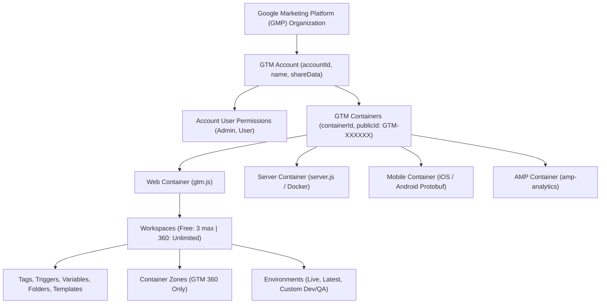
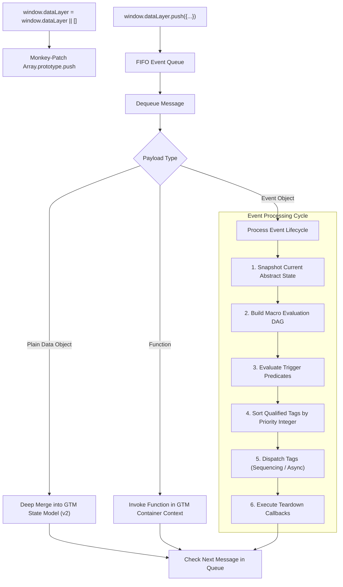
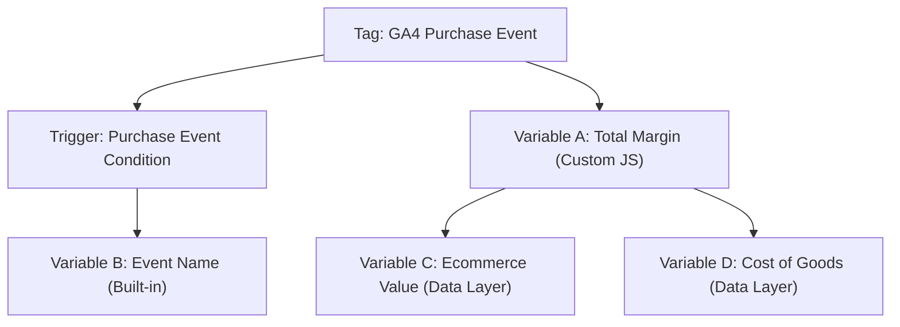
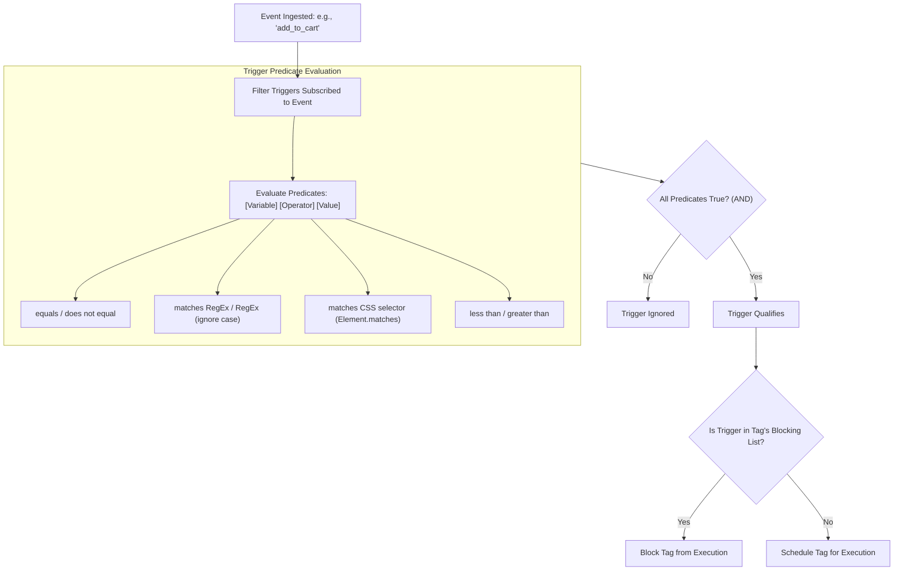
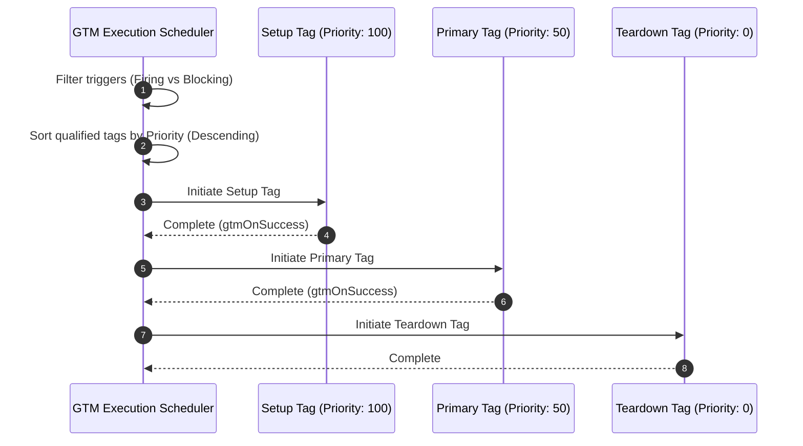
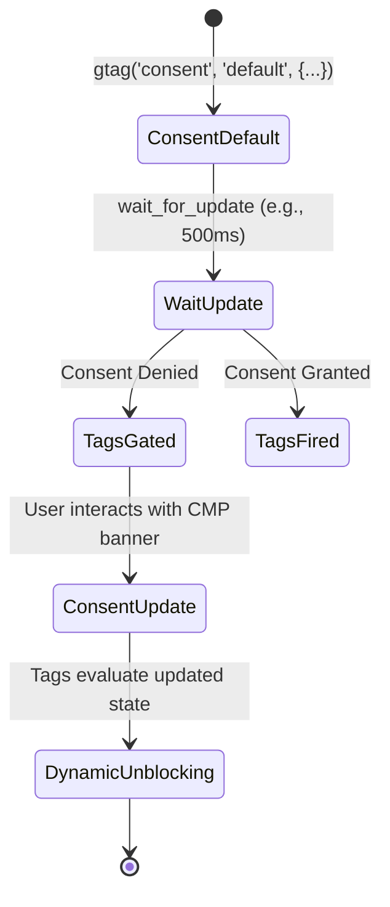
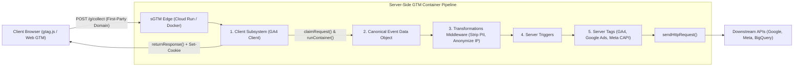
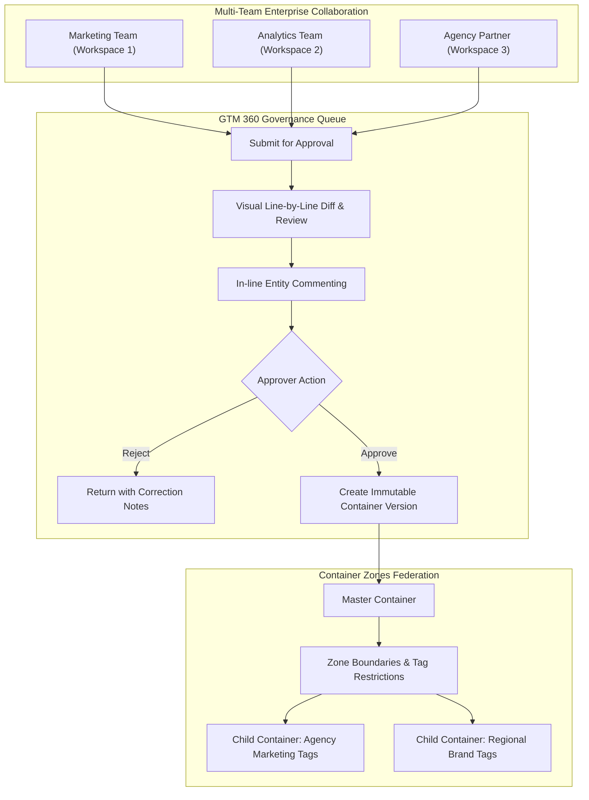

# Google Tag Manager (GTM) Specification: Free vs. GTM 360 Enterprise
## A Comprehensive Functional, Technical, and Architectural Requirements Specification (SRS/FRS)

---

### Document Overview
This document serves as the exhaustive, production-grade functional and technical specification for Google Tag Manager (GTM), detailing both the **Standard (Free)** and **360 (Enterprise)** offerings. It is written to provide an engineering blueprint for technical analysts, product managers, and systems architects building, auditing, or implementing an enterprise-grade tag management engine.

---

## Module 1: Account, Container, & Workspace Management System



### 1.1 Account-Level Architecture & Hierarchy
* **Account Entity Schema**:
  * `accountId`: Unique numerical string assigned upon creation.
  * `name`: Descriptive organizational label (1–100 UTF-8 characters).
  * `shareData`: Boolean flag authorizing anonymous data aggregation for Google benchmarking services.
  * `fingerprint`: Optimistic concurrency control string updated on every write mutation.
  * `gmpOrganizationId`: (Optional) Foreign key linking to an enterprise Google Marketing Platform (GMP) parent entity.
* **GMP Organization Linking (GTM 360 Only)**:
  * Links the GTM account to an enterprise Google Marketing Platform contract.
  * Unlocks GTM 360 container licensing, enterprise billing consolidated with GA4 360 and Display & Video 360, dedicated technical support tiers, and formal Service Level Agreements (SLAs).

### 1.2 Container Runtime Topologies & Injection Mechanics

| Container Runtime | Execution Environment | Compilation Artifact | Injection / Delivery Mechanism |
| :--- | :--- | :--- | :--- |
| **Web Container** | Web Browser DOM/BOM | `gtm.js` (JavaScript AST) | `<script>` async fetch in `<head>` + `<iframe>` fallback in `<body>` |
| **Server Container** | Node.js Backend Container | `server.js` (Node HTTP engine) | Docker container hosted on Google Cloud Run or custom Kubernetes/VM |
| **iOS Container** | iOS Native Application | Compiled Protocol Buffer (`.bin`) | Google Analytics for Firebase iOS SDK bundle + remote sync |
| **Android Container**| Android Native Application | Compiled Protocol Buffer (`.bin`) | Google Analytics for Firebase Android SDK bundle + remote sync |
| **AMP Container** | Accelerated Mobile Pages | Declarative JSON configuration | `<amp-analytics type="googleanalytics">` configuration block |

#### Web Container Snippet Specification & Wire Mechanics

```html
<!-- Google Tag Manager (Head Snippet) -->
<script>(function(w,d,s,l,i){w[l]=w[l]||[];w[l].push({'gtm.start':
new Date().getTime(),event:'gtm.js'});var f=d.getElementsByTagName(s)[0],
j=d.createElement(s),dl=l!='dataLayer'?'&l='+l:'';j.async=true;j.src=
'https://www.googletagmanager.com/gtm.js?id='+i+dl;f.parentNode.insertBefore(j,f);
})(window,document,'script','dataLayer','GTM-XXXXXXX');</script>
<!-- End Google Tag Manager -->
```

* **Line-by-Line Execution Analysis**:
  1. `(function(w,d,s,l,i){ ... })(window,document,'script','dataLayer','GTM-XXXXXXX');`: Self-invoking anonymous closure scoping variables to avoid polluting the global namespace.
  2. `w[l]=w[l]||[];`: Evaluates if `window.dataLayer` exists; if not, instantiates an empty Array literal (`[]`).
  3. `w[l].push({'gtm.start': new Date().getTime(), event:'gtm.js'});`: Emits the initial high-resolution timestamp microtask and the baseline `gtm.js` event into the queue.
  4. `var f=d.getElementsByTagName(s)[0], j=d.createElement(s)`: Identifies the first script tag in the document to establish a deterministic DOM insertion reference point.
  5. `dl=l!='dataLayer'?'&l='+l:'';`: Appends the query parameter `&l=` only if the developer renamed the default `dataLayer` identifier.
  6. `j.async=true;`: Sets the HTML5 asynchronous execution attribute, ensuring script download does not block the browser parser.
  7. `j.src='https://www.googletagmanager.com/gtm.js?id='+i+dl;`: Generates the CDN fetch URI targeting Google's edge cache.
  8. `f.parentNode.insertBefore(j,f);`: Injects the configured script element directly above the reference node.

```html
<!-- Google Tag Manager (Noscript Body Fallback) -->
<noscript><iframe src="https://www.googletagmanager.com/ns.html?id=GTM-XXXXXXX"
height="0" width="0" style="display:none;visibility:hidden"></iframe></noscript>
<!-- End Google Tag Manager -->
```

* **Noscript Fallback Execution**:
  * Executed exclusively when client browsers have JavaScript disabled.
  * Injects an invisible `<iframe>` loading `ns.html`.
  * Allows purely declarative image-based tags (Custom Image Tags) to execute via HTTP GET requests decorated with macro values.

### 1.3 Container JSON Schema Specification
The complete serialized GTM container model conforms to the following JSON specification:

```json
{
  "exportFormatVersion": 2,
  "exportTime": "2026-11-03 12:00:00",
  "containerVersion": {
    "path": "accounts/10001/containers/20002/versions/42",
    "accountId": "10001",
    "containerId": "20002",
    "containerVersionId": "42",
    "name": "Production Release v4.2",
    "description": "Production release incorporating Consent Mode v2 and GA4 ecommerce",
    "container": {
      "path": "accounts/10001/containers/20002",
      "accountId": "10001",
      "containerId": "20002",
      "name": "Corporate Global Web",
      "publicId": "GTM-XXXXXXX",
      "usageContext": ["WEB"],
      "fingerprint": "1700000000000",
      "tagManagerUrl": "https://tagmanager.google.com/#/container/accounts/10001/containers/20002",
      "features": {
        "supportUserPermissions": true,
        "supportEnvironments": true,
        "supportWorkspaces": true,
        "supportZones": true
      }
    },
    "tag": [],
    "trigger": [],
    "variable": [],
    "builtInVariable": [],
    "customTemplate": [],
    "folder": [],
    "zone": []
  }
}
```

#### Compiled Runtime AST Container Specification (`gtm.js` Core Engine)
When GTM compiles a container into `gtm.js`, it does not interpret user-defined names. It minifies the container into an optimized, zero-based array index dependency graph inside a `resource` dictionary:

```json
{
  "resource": {
    "version": "42",
    "macros": [
      { "function": "__e" },
      { "function": "__v", "vtp_name": "ecommerce.value", "vtp_dataLayerVersion": 2 },
      { "function": "__u", "vtp_component": "PATH" }
    ],
    "predicates": [
      { "function": "_eq", "arg0": ["macro", 0], "arg1": "purchase" },
      { "function": "_re", "arg0": ["macro", 2], "arg1": "^/checkout/.*" }
    ],
    "rules": [
      [
        ["if", 0, 1],
        ["add", 0]
      ]
    ],
    "tags": [
      {
        "function": "__gaawe",
        "priority": 10,
        "vtp_eventName": "purchase",
        "vtp_measurementId": "G-XXXXXXXXXX",
        "tag_id": 1
      }
    ]
  }
}
```

* **Index Pointer Mechanics**:
  * `macros`: Dynamic getters (e.g., `__e` is `Event`, `__v` is `Data Layer Variable`, `__u` is `URL`).
  * `predicates`: Comparison operators (e.g., `_eq` is strict equality, `_re` is regular expression). `arg0` points to `["macro", index]`.
  * `rules`: Integer index tuples. `["if", 0, 1]` means: execute if predicates at index `0` AND index `1` evaluate to `true`.
  * `tags`: `["add", 0]` schedules the tag at index `0` for execution.

#### Container Import Collision Resolution Modes
* **Overwrite Mode**: Erases all existing tags, triggers, variables, templates, and folders in the active workspace and applies the imported JSON payload.
* **Merge Mode**: Preserves existing non-conflicting entities.
  * *Option: Overwrite Conflicting Entities*: Overwrites matching target entities with imported definitions.
  * *Option: Rename Conflicting Entities*: Appends an incremental integer suffix (e.g., `GA4 Page View - Import Copy`) to preserve existing configurations.

### 1.4 Workspaces & Git-like Branching Architecture
* **Standard (Free) Limit**: Exactly **3 Workspaces** per container (1 default workspace + 2 concurrent user workspaces).
* **GTM 360 Enterprise Limit**: **Unlimited Workspaces**.
* **Branching & Sync Lifecycle**:
  1. **Fork Branch**: Clones the state of the designated base container version into an isolated editable workspace database.
  2. **Isolated Mutation**: CRUD operations on tags, triggers, variables, and templates occur in isolated workspace state without mutating live traffic or peer branches.
  3. **Upstream Sync**: Evaluates whether production changes have been published since the workspace was branched.
  4. **Three-Way Conflict Resolution Engine**:
     * If an entity was mutated in both production and the current workspace, GTM halts the sync and presents an interactive visual diff.
     * Actions: Accept Incoming (Production) or Retain Workspace Version.
  5. **Compilation & Version Freeze**: Bundles the workspace into an immutable, versioned snapshot.

---

## Module 2: Data Layer Core Engine & Runtime (Web)



### 2.1 The `window.dataLayer` Observer Pattern & Monkey-Patching
Before `gtm.js` initializes, `window.dataLayer.push` is the native `Array.prototype.push`.
When `gtm.js` evaluates, it monkey-patches `window.dataLayer.push` using the following internal architectural pattern:

```javascript
// Internal architectural abstraction of GTM's dataLayer listener
(function() {
  var dataLayerInstance = window.dataLayer = window.dataLayer || [];
  var internalQueue = [];
  var isProcessing = false;

  // Intercept the native push implementation
  var originalPush = dataLayerInstance.push;
  dataLayerInstance.push = function() {
    var args = [].slice.call(arguments, 0);
    // 1. Maintain native array persistence
    var result = originalPush.apply(dataLayerInstance, args);
    // 2. Route messages to the FIFO processing pipeline
    for (var i = 0; i < args.length; i++) {
      internalQueue.push(args[i]);
    }
    if (!isProcessing) {
      drainQueue();
    }
    return result;
  };

  function drainQueue() {
    isProcessing = true;
    while (internalQueue.length > 0) {
      var item = internalQueue.shift();
      gtmProcessMessage(item);
    }
    isProcessing = false;
  }
})();
```

### 2.2 Payload Types & Processing Semantics
1. **Data Object (State-Only Push)**:
   ```javascript
   window.dataLayer.push({
     user_id: 'USR_88291',
     loyalty_tier: 'Gold',
     account_balance: 420.50
   });
   ```
   * *Behavior*: Contains no `event` key. Merges key-value pairs directly into GTM's internal state tree. No triggers are evaluated; no tags are fired.
2. **Event Object (Triggering Push)**:
   ```javascript
   window.dataLayer.push({
     event: 'add_to_cart',
     ecommerce: {
       currency: 'USD',
       value: 59.99,
       items: [{ item_id: 'SKU_99', item_name: 'Oxford Shirt', price: 59.99, quantity: 1 }]
     }
   });
   ```
   * *Behavior*: Contains an `event` key. Causes GTM to freeze state, resolve all dependent macros, evaluate triggers subscribing to `add_to_cart`, dispatch qualified tags, and invoke teardown hooks.
3. **Function Push**:
   ```javascript
   window.dataLayer.push(function() {
     var container = this.google_tag_manager['GTM-XXXXXXX'];
     var currentData = container.dataLayer.get('ecommerce.value');
     console.log('Value evaluated in container context:', currentData);
   });
   ```
   * *Behavior*: An anonymous function pushed to `dataLayer` executes immediately within the internal closure of the GTM container, granting access to private helper methods.

### 2.3 Data Layer Versioning & Recursive Merging Logic
* **Version 2 (Default)**:
  * Implements recursive deep merging for nested objects.
  * Dot-notation strings (e.g., `ecommerce.items.0.price`) traverse nested structures.
  * **Array Overwrite Rule**: Arrays are treated as primitive values during merges. Pushing `{ items: [B] }` over an existing `{ items: [A] }` completely replaces the array (`items` becomes `[B]`, not `[A, B]`).
  * **Clearing Semantics**: To clear an existing object or array, push `{ key: undefined }` or `{ key: null }`.
* **Version 1 (Legacy Universal Analytics Style)**:
  * Performs shallow assignment. Nested sub-objects are replaced completely rather than merged recursively.

### 2.4 Built-in Synthetic Runtime Lifecycle Events

| Event Name (`event`) | Execution Phase / DOM Hook | Emitted Built-in Variables | Purpose & Typical Tags |
| :--- | :--- | :--- | :--- |
| `gtm.js` | Immediately upon `gtm.js` script parsing | `gtm.start`, `gtm.uniqueEventId` | Consent default initialization, Core Google tags, Config tags |
| `gtm.dom` | `DOMContentLoaded` browser event | `gtm.uniqueEventId` | Safe DOM traversal, scraping forms, UI element listeners |
| `gtm.load` | `window.onload` (all assets/images loaded) | `gtm.uniqueEventId` | Low-priority third-party marketing tags, affiliate networks |
| `gtm.click` | Click event bubbled to `document` | `gtm.element`, `gtm.elementClasses`, `gtm.elementId`, `gtm.elementUrl` | Tracking arbitrary clicks on buttons, divs, spans |
| `gtm.linkClick`| Click event on anchor (`<a>`) tag | Same as click + `gtm.elementTarget` | Outbound link clicks, file downloads, CTA navigation |
| `gtm.formSubmit` | Submit event emitted on `<form>` | `gtm.element`, `gtm.elementId`, `gtm.elementClasses` | Lead generation capture, registration tracking |
| `gtm.scrollDepth`| Window scroll crosses defined depth | `gtm.scrollThreshold`, `gtm.scrollUnits`, `gtm.scrollDirection` | Long-form content consumption, reading depth |
| `gtm.video` | YouTube Iframe player state change | `gtm.videoProvider`, `gtm.videoStatus`, `gtm.videoPercent` | Video plays, progress milestones (25%, 50%, 75%), completions |
| `gtm.timer` | Timer interval elapsed | `gtm.timerId`, `gtm.timerEventNumber`, `gtm.timerInterval` | Time-on-page engagement thresholds (e.g., 30s engaged reader) |
| `gtm.pageError` | Uncaught error caught by `window.onerror` | `gtm.errorMessage`, `gtm.errorUrl`, `gtm.errorLine` | Frontend bug telemetry, JavaScript exception reporting |
| `gtm.historyChange` | HTML5 History API mutation (`pushState`) | `gtm.historySource`, `gtm.oldUrlFragment`, `gtm.newUrlFragment` | Single Page Application (SPA) virtual pageviews |

### 2.5 The Macro Dependency DAG & Topological Evaluation Engine
When evaluating tags and triggers, GTM variables frequently depend on other variables (e.g., Variable A is a Custom JavaScript function reading Variable B, which reads a Data Layer Variable C).



#### Architectural Algorithms:
1. **Directed Acyclic Graph (DAG) Construction**:
   * Prior to container execution, GTM builds an adjacency graph representing all variable dependencies.
   * **Cycle Detection**: The compiler performs Depth-First Search (DFS). If a back-edge is encountered ($V_1 \rightarrow V_2 \rightarrow V_1$), the compiler flags a circular dependency error and prevents infinite runtime recursion.
2. **Topological Ordering**:
   * Variables are resolved according to their topological sort order, guaranteeing that dependencies are fully resolved before dependent expressions evaluate.
3. **Per-Event Memoization / Value Caching**:
   * Each event cycle is assigned a monotonic `uniqueEventId` integer.
   * When Variable $V$ is evaluated, its resolved return value is stored in an in-memory cache keyed by `(uniqueEventId, variableId)`.
   * If 15 different tags reference `{{DLV - User ID}}`, the variable is evaluated **exactly once** during that event, preventing redundant DOM queries or computation.

---

## Module 3: Trigger Evaluation Engine & Predicate Matching



### 3.1 Trigger Predicates & Operator Specification
Every trigger filter evaluates: `[Variable] [Operator] [Value]`.

#### Complete Operator Mathematical & Algorithmic Definitions:
1. `equals` / `does not equal`: Strict string equality (`String(variable) === String(value)`).
2. `contains` / `does not contain`: Substring inclusion via `String(variable).indexOf(String(value)) !== -1`.
3. `starts with` / `does not start with`: Prefix matching via `String(variable).indexOf(String(value)) === 0`.
4. `ends with` / `does not end with`: Suffix matching via `String(variable).endsWith(String(value))`.
5. `matches RegEx` / `does not match RegEx`: Compiles `new RegExp(value)`. Evaluates `regex.test(String(variable))`. Supports full JavaScript regex syntax, backreferences, and lookaheads.
6. `matches RegEx (ignore case)`: Compiles `new RegExp(value, 'i')`.
7. `matches CSS selector` / `does not match CSS selector`:
   * Uses `Element.matches(selector)` or `Element.msMatchesSelector(selector)`.
   * Evaluates if the clicked DOM node (or any parent node matching via `.closest(selector)`) satisfies the CSS3 query selector string.
8. `less than` / `less than or equal to`: Coerces inputs to numbers via `parseFloat(variable) < parseFloat(value)`.
9. `greater than` / `greater than or equal to`: Coerces inputs to numbers via `parseFloat(variable) > parseFloat(value)`.

### 3.2 Exhaustive Trigger Type Catalog

#### 1. Pageview Triggers
* **Page View**: Evaluates when `event === 'gtm.js'`. Fires before DOM tree construction is guaranteed.
* **DOM Ready**: Evaluates when `event === 'gtm.dom'`. Fires at `document.readyState === 'interactive'`.
* **Window Loaded**: Evaluates when `event === 'gtm.load'`. Fires at `document.readyState === 'complete'`.

#### 2. Click Triggers
* **All Elements**:
  * Bound to `document.addEventListener('click', handler, true)` (capturing phase).
  * Captures clicks on any HTML node. Resolves SVG element `className` correctly (`element.className.baseVal` vs `element.className`).
* **Just Links**:
  * Specifically targets `<a>` elements and their descendants.
  * **Wait for Tags**: Intercepts link navigation (`event.preventDefault()`). Holds browser navigation until all dependent tags complete execution or until the configured timeout (e.g., 2000ms) expires, then resumes navigation via `window.location = href`.
  * **Check Validation**: Only fires if `event.defaultPrevented === false`. If another script stopped the link click, GTM skips firing.

#### 3. User Engagement Triggers
* **Element Visibility**:
  * **Selection Method**: ID (`#my-element`) or CSS Selector (`.promo-banner`).
  * **Firing Frequency**:
    * *Once per page*: Fires only the first time any matching element appears.
    * *Once per element*: Fires once for each unique DOM element matching the selector.
    * *Every time an element appears on screen*: Fires whenever an element re-enters the viewport.
  * **Minimum Percent Visible**: Floating point threshold (1% to 100%).
  * **Continuous Screen Duration**: Minimum continuous milliseconds the element must remain visible before firing (e.g., 2000ms for IAB ad viewability).
  * **Observe DOM changes**: Attaches a `MutationObserver` to `document.body` (`childList: true, subtree: true, attributes: true`) to automatically detect dynamically inserted elements in SPAs.
* **Scroll Depth**:
  * **Axes**: Vertical and/or Horizontal.
  * **Threshold Units**: Percentages (e.g., `25, 50, 75, 90`) or Pixels (e.g., `500, 1000, 2000`).
  * Throttled via `requestAnimationFrame` debouncing to preserve scrolling performance.
* **YouTube Video**:
  * Automatically scans DOM for `<iframe>` elements pointing to `youtube.com` or `youtube-nocookie.com`.
  * Injects `enablejsapi=1` and `origin` query parameters into iframe `src` attributes dynamically.
  * Injects the YouTube Iframe Player API script (`https://www.youtube.com/iframe_api`).
  * Listens to postMessage events bridging `{"event":"listening","id":...}`.
  * Tracks player states: `-1` (unstarted), `0` (ended), `1` (playing), `2` (paused), `3` (buffering), `5` (video cued).

#### 4. Form Submission Triggers
* **Form Submission**:
  * Intercepts `submit` events on `HTMLFormElement`.
  * Monkey-patches `HTMLFormElement.prototype.submit` so programmatic submissions via JavaScript also trigger GTM listeners.
  * **Wait for Tags**: Delays form navigation up to specified milliseconds limit.
  * **Check Validation**: Inspects HTML5 form validity (`form.checkValidity()`). Prevents tags from firing if required fields are missing.

#### 5. History & Error Triggers
* **History Change**:
  * Intercepts HTML5 History API: wraps `window.history.pushState` and `window.history.replaceState`.
  * Binds to `window.addEventListener('popstate')` and `window.addEventListener('hashchange')`.
  * Exposes variables: `History Source`, `Old History Fragment`, `New History Fragment`, `Old History State`, `New History State`.
* **JavaScript Error**:
  * Binds to `window.addEventListener('error', handler)`.
  * Captures: `Error Message`, `Error URL`, `Error Line Number`.

#### 6. Orchestration Triggers
* **Custom Event**: Evaluates user-defined strings pushed via `dataLayer.push({ event: 'custom_name' })`. Supports regex matching on event names.
* **Timer**:
  * Parameters: `Interval` (milliseconds), `Limit` (maximum number of executions).
  * Automatically registers and clears `setInterval()` timers.
* **Trigger Group**:
  * Metatrigger referencing 2 or more existing triggers.
  * Maintains an internal bitmask/counter during the page session.
  * Only dispatches an event when **every single trigger in the group** has fired at least once during the page lifecycle.

---

## Module 4: Variables Subsystem (Built-in & User-Defined)

### 4.1 Exhaustive Built-in Variables Specification

| Variable Name | Internal Macro Token | Resolution Implementation / DOM API Source | Return Type | Fallback Value |
| :--- | :--- | :--- | :--- | :--- |
| `Page URL` | `{{Page URL}}` | `window.location.href` | String | `""` |
| `Page Hostname` | `{{Page Hostname}}`| `window.location.hostname` | String | `""` |
| `Page Path` | `{{Page Path}}` | `window.location.pathname` | String | `""` |
| `Referrer` | `{{Referrer}}` | `document.referrer` | String | `""` |
| `Event` | `{{Event}}` | Internal `event` key from triggering `dataLayer.push` | String | `undefined` |
| `Container ID` | `{{Container ID}}` | Container public identifier (e.g., `GTM-XXXXXXX`) | String | Constant |
| `Container Version`| `{{Container Version}}`| Current integer container version string | String | Constant |
| `Environment Name`| `{{Environment Name}}`| Active environment name (e.g., `Live`, `Staging`) | String | Constant |
| `Random Number` | `{{Random Number}}`| `Math.floor(Math.random() * 2147483647)` (32-bit int) | Integer | `0` |
| `HTML ID` | `{{HTML ID}}` | Numeric tag identifier assigned to Custom HTML tags | String | `""` |
| `Click Element` | `{{Click Element}}`| Pointer to the DOM Node that received the click | DOM Node | `null` |
| `Click Classes` | `{{Click Classes}}`| `event.target.getAttribute('class')` | String | `""` |
| `Click ID` | `{{Click ID}}` | `event.target.getAttribute('id')` | String | `""` |
| `Click Target` | `{{Click Target}}` | `event.target.getAttribute('target')` | String | `""` |
| `Click URL` | `{{Click URL}}` | `event.target.href` or `event.target.src` | String | `""` |
| `Click Text` | `{{Click Text}}` | `event.target.innerText` or `event.target.textContent` | String | `""` |
| `Form Element` | `{{Form Element}}` | Pointer to the HTML `<form>` element | DOM Node | `null` |
| `Form Classes` | `{{Form Classes}}` | `form.getAttribute('class')` | String | `""` |
| `Form ID` | `{{Form ID}}` | `form.getAttribute('id')` | String | `""` |
| `Form Target` | `{{Form Target}}` | `form.getAttribute('target')` | String | `""` |
| `Form URL` | `{{Form URL}}` | `form.getAttribute('action')` | String | `""` |
| `Form Text` | `{{Form Text}}` | Textual content inside the submitted form | String | `""` |
| `Scroll Depth Threshold` | `{{Scroll Depth Threshold}}` | Milestone value that fired the event (e.g., `50`) | Integer | `0` |
| `Scroll Depth Units` | `{{Scroll Depth Units}}` | `'percent'` or `'pixels'` | String | `'percent'` |
| `Scroll Direction` | `{{Scroll Direction}}` | `'vertical'` or `'horizontal'` | String | `'vertical'` |
| `Percent Visible` | `{{Percent Visible}}` | Ratio of element visible in viewport (0–100) | Integer | `0` |
| `On Screen Duration`| `{{On Screen Duration}}`| Milliseconds element has continuously remained visible | Integer | `0` |
| `Video Provider` | `{{Video Provider}}`| Fixed string: `'youtube'` | String | `""` |
| `Video Status` | `{{Video Status}}` | `'start'`, `'pause'`, `'progress'`, `'complete'` | String | `""` |
| `Video URL` | `{{Video URL}}` | `player.getVideoUrl()` | String | `""` |
| `Video Title` | `{{Video Title}}` | Video metadata title string | String | `""` |
| `Video Duration` | `{{Video Duration}}`| Total video duration in seconds (`player.getDuration()`) | Integer | `0` |
| `Video Current Time`| `{{Video Current Time}}`| Current playback head in seconds (`player.getCurrentTime()`) | Integer | `0` |
| `Video Percent` | `{{Video Percent}}` | Calculated percentage of video played (`(time/dur)*100`) | Integer | `0` |
| `Video Visible` | `{{Video Visible}}` | Boolean indicating if player is inside viewport | Boolean | `false` |
| `Error Message` | `{{Error Message}}` | Error message string from `window.onerror` | String | `""` |
| `Error URL` | `{{Error URL}}` | Source file URL that threw exception | String | `""` |
| `Error Line` | `{{Error Line}}` | Line number where exception occurred | Integer | `0` |

### 4.2 User-Defined Variable Types Specification

#### 1. Data Layer Variable
* **Configuration**: `dataLayerVariableName` (string), `dataLayerVersion` (1 or 2), `defaultValue` (any).
* **Resolution**: Performs recursive path traversal against the active GTM state model using dot notation (e.g., `ecommerce.items.0.price`). If path does not exist, returns `defaultValue` (or `undefined`).

#### 2. First-Party Cookie
* **Configuration**: `cookieName` (string), `uriDecode` (boolean).
* **Resolution**: Reads `document.cookie`, parses key-value pairs separated by semicolons, extracts value for `cookieName`, and optionally applies `decodeURIComponent()`.

#### 3. Custom JavaScript Variable
* **Configuration**: Anonymous JavaScript function string.
* **Resolution**: Evaluated via an immediately invoked function expression (IIFE):
  ```javascript
  (function() {
    return window.innerWidth > 768 ? 'Desktop' : 'Mobile';
  })()
  ```
* **Execution Rules**: Must return a value. If it throws an uncaught exception, GTM catches the error and assigns `undefined` to the variable.

#### 4. JavaScript Variable
* **Configuration**: `javascriptVariableName` (string).
* **Resolution**: Traverses properties on the global `window` object using dot notation (e.g., `App.Auth.currentUser.id`). Returns `undefined` if any segment in the chain is missing.

#### 5. DOM Element Variable
* **Configuration**: `selectionMethod` (`ID` or `CSS`), `elementId` / `elementSelector`, `attributeName` (optional).
* **Resolution**: Queries DOM via `document.getElementById` or `document.querySelector`. If `attributeName` is specified, returns `element.getAttribute(attr)`; otherwise, returns `element.innerText`.

#### 6. URL Variable
* **Configuration**: `component` (`Protocol`, `Host`, `Port`, `Path`, `File Extension`, `Query`, `Fragment`), `queryKey` (string, required if component is `Query`).
* **Resolution**: Parses `window.location.href` (or an input variable) into standard URI components.

#### 7. HTTP Referrer Variable
* **Configuration**: Component selection identical to URL variable.
* **Resolution**: Parses `document.referrer`.

#### 8. Lookup Table Variable
* **Configuration**: `inputVariable`, `lookupTable` (Array of `{ input: string, output: any }`), `defaultValue`.
* **Resolution**: Performs strict linear search matching `inputVariable === row.input`. Returns first matching `output`. If no match, returns `defaultValue`.

#### 9. RegEx Table Variable
* **Configuration**: `inputVariable`, `regExTable` (Array of `{ pattern: string, output: string }`), `ignoreCase` (boolean), `fullMatch` (boolean), `enableCaptureGroups` (boolean), `defaultValue`.
* **Resolution**:
  * Compiles each pattern: `new RegExp(row.pattern, flags)`.
  * If `fullMatch` is true, enforces `^...$`.
  * If `enableCaptureGroups` is true, replaces `$1`, `$2`, etc. in `output` with matched capture groups.

#### 10. Google Tag Configuration Settings & Event Settings Variables
* **Configuration**: Structured table of configuration parameters (e.g., `send_page_view`, `server_container_url`) and event parameters.
* **Resolution**: Inherited globally across all Google Tags (`gtag`) or GA4 Event Tags, eliminating redundant parameter declarations.

---

## Module 5: Tag Subsystem, Execution Lifecycle & Concurrency



### 5.1 Tag Data Model & Parameter Structure
* **Tag Entity Fields**:
  * `tagId`: Unique string ID.
  * `name`: User-facing label.
  * `type`: Tag type identifier (e.g., `gaaw_opts`, `html`, `img`, `googtag`).
  * `firingTriggerId`: Array of trigger IDs that cause the tag to fire.
  * `blockingTriggerId`: Array of exception trigger IDs that block the tag from firing.
  * `priority`: Integer value (positive or negative; default: `0`).
  * `firingOption`: Enum (`ONCE_PER_EVENT`, `ONCE_PER_PAGE`, `UNLIMITED`).
  * `setupTag`: Array of `{ tagName: string, stopOnSetupFailure: boolean }`.
  * `teardownTag`: Array of `{ tagName: string }`.
  * `consentSettings`: Object detailing consent enforcement rules.
  * `parameter`: Array of key-value dictionaries defining tag configuration.

### 5.2 Tag Execution Scheduler & Priority Mechanics
1. **Trigger Filtering**: Compares event against `firingTriggerId`. If any `blockingTriggerId` evaluates to `true`, the tag is immediately removed from the execution queue.
2. **Priority Sorting**: Tags are sorted in descending order of their `priority` integer. A tag with priority `100` is initiated before a tag with priority `10`.
3. **Asynchronous Non-Blocking Execution**: GTM does **not** wait for a high-priority tag's network request to resolve before initiating the next tag, unless explicit **Tag Sequencing** is defined.
4. **Tag Sequencing State Machine**:
   * If `setupTag` is defined, the primary tag is suspended until the setup tag signals completion (`gtmOnSuccess`).
   * If the setup tag fails (`gtmOnFailure`) and `stopOnSetupFailure === true`, the primary tag and teardown tag are aborted.
   * After the primary tag finishes execution, `teardownTag` is immediately dispatched.
5. **Firing Frequency Enforcement**:
   * `ONCE_PER_EVENT`: Fired on every matching event.
   * `ONCE_PER_PAGE`: Fired once per document lifecycle; subsequent matching events are ignored.
   * `UNLIMITED`: Legacy setting allowing multiple fires.

### 5.3 Native Tag Type Specifications
* **Google Tag (`googtag`)**: The core Google tag for GA4 and Google Ads. Configures Measurement IDs (`G-XXXXXXX` / `AW-XXXXXXX`), routes requests to Server-Side containers via `server_container_url`, and handles global settings.
* **GA4 Event Tag (`gaawe`)**: Dispatches GA4 custom and recommended events with parameters, user properties, and ecommerce payloads.
* **Google Ads Conversion Tracking**: Fires conversion pings with `conversion_id`, `conversion_label`, `value`, `currency`, and `transaction_id`.
* **Google Ads Remarketing**: Transmits vertical-specific remarketing parameters (e.g., `ecomm_prodid`, `ecomm_totalvalue`).
* **Conversion Linker**: Automatically detects click identifiers (`gclid`, `gbraid`, `wbraid`) in URL parameters and writes first-party cookies (`_gcl_aw`, `_gcl_dc`) on the root domain.
* **Custom HTML Tag (`html`)**:
  * Injects raw HTML/JavaScript into the DOM.
  * Supports `document.write` option (via a safe streaming wrapper).
  * *Standard Tier Limit*: Capped at **102,400 characters (~102 KB)** per tag.
  * *360 Enterprise Tier Limit*: **Unlimited**.
* **Custom Image Tag (`img`)**: Creates an off-screen `` element (`new Image()`) and sets `.src = url` to fire cookieless GET beacons.

---

## Module 6: Consent Management Engine (Consent Mode v2)



### 6.1 The 7 Consent Types
GTM natively enforces 7 distinct consent parameters:
1. `ad_storage`: Governs writing/reading of advertising cookies (e.g., `_gcl_au`, Google Ads conversion cookies).
2. `analytics_storage`: Governs writing/reading of analytics cookies (e.g., `_ga`, `_gid`).
3. `ad_user_data`: Controls whether user personal data (email, phone, address) can be sent to Google advertising services.
4. `ad_personalization`: Controls whether data can be used for personalized remarketing.
5. `functionality_storage`: Controls cookies required for basic site functionality.
6. `personalization_storage`: Controls cookies used for recommendations and user customization.
7. `security_storage`: Controls cookies required for security, authentication, and fraud prevention.

### 6.2 Consent Initialization & Update Commands

```javascript
// 1. Consent Default (Must execute BEFORE GTM snippet)
gtag('consent', 'default', {
  'ad_storage': 'denied',
  'analytics_storage': 'denied',
  'ad_user_data': 'denied',
  'ad_personalization': 'denied',
  'wait_for_update': 500 // Holds tags for up to 500ms waiting for CMP
});

// 2. Consent Update (Executed when user interacts with CMP banner)
gtag('consent', 'update', {
  'ad_storage': 'granted',
  'analytics_storage': 'granted',
  'ad_user_data': 'granted',
  'ad_personalization': 'granted'
});
```

### 6.3 Wire Format Encoding (`gcs` and `gcd`)
* **`gcs` (Google Consent Status)**:
  * 4-character format: `G1[ad_storage][analytics_storage]`.
  * `G111`: Both granted.
  * `G100`: Both denied.
  * `G110`: `ad_storage` granted, `analytics_storage` denied.
* **`gcd` (Google Consent Default / Data - Consent Mode v2)**:
  * String format: `13<ad_storage>3<analytics_storage>3<ad_user_data>3<ad_personalization>5` (e.g., `13r3r3r3r5`).
  * Matrix of States:
    * `l`: Signal not set (no consent mode active).
    * `p`: Denied by default, no update.
    * `q`: Denied by default, denied after update.
    * `r`: Denied by default, **granted after update** (user accepted).
    * `t`: Granted by default, no update.
    * `m`: Denied after update (no default set).
    * `n`: Granted after update (no default set).
    * `u`: Granted by default, denied after update.
    * `v`: Granted by default, granted after update.

---

## Module 7: Server-Side Tagging (sGTM) In-Depth Architecture



### 7.1 Server Container Runtime & Hosting Topology
* **Runtime**: High-performance Node.js container packaged in Docker (`gcr.io/cloud-tagging-102420/gtm-cloud-image:latest`).
* **Deployment Architectures**:
  * **Google Cloud Run (Managed)**: Auto-scaled, serverless microservice. Automatically provisions HTTPS certificates and handles horizontal scaling from 0 to thousands of container instances.
  * **Self-Hosted (Kubernetes, AWS ECS/Fargate, Azure App Service, Bare-Metal Docker)**:
    * Environment variables: `PORT=8080`, `CONTAINER_CONFIG=<base64-string>`, `RUN_AS_PREVIEW_SERVER=true/false`.
* **First-Party Domain Setup**: Mapped to a subdomain of the main website (e.g., `metrics.brand.com` pointing via DNS A/AAAA or CNAME records to the sGTM load balancer).

### 7.2 The Server Request Pipeline
1. **HTTP Ingestion**: Incoming HTTP GET/POST request hits the server container endpoint (e.g., `https://metrics.brand.com/g/collect`).
2. **Client Subsystem**:
   * Every configured Client inspects the request using `claimRequest()`.
   * The first Client that matches the request path (e.g., `/g/collect` matching the GA4 Client) claims exclusive handling.
   * The Client parses the payload (Measurement Protocol query parameters or JSON body) into the standardized **Event Data** object.
   * Calls `runContainer(eventData, callback)`.
3. **Transformations Middleware**: Evaluates configured transformation rules:
   * Parameter allowlists/blocklists.
   * Parameter augmentation (injecting API secrets, backend database lookups).
   * PII scrubbing (hashing email/phone with SHA-256).
4. **Trigger Evaluation**: Server-side triggers inspect the transformed Event Data object.
5. **Tag Execution**: Server tags execute outbound network requests via `sendHttpRequest()`.
6. **HTTP Response Generation**: The Client invokes `returnResponse()`, transmitting HTTP status codes (`200 OK`, `204 No Content`), headers, and `Set-Cookie` directives back to the browser.

### 7.3 Canonical Event Data Schema Dictionary

| Field Key | Type | Description |
| :--- | :--- | :--- |
| `event_name` | String | Standardized event name (e.g., `'purchase'`, `'page_view'`) |
| `client_id` | String | Unique browser/client identifier (e.g., `1892837192.1700000000`) |
| `user_id` | String | Authenticated customer ID |
| `page_location` | String | Full URL where the event originated |
| `page_referrer` | String | HTTP referring URL |
| `ip_override` | String | Client IP address extracted from TCP connection or `X-Forwarded-For` |
| `user_agent` | String | Raw client User-Agent string |
| `items` | Array of Objects | Standardized array of ecommerce items |
| `user_data` | Object | User personal data: `email_address`, `phone_number`, `address` |

### 7.4 Cookie Prolongation & Apple Safari ITP Circumvention
* **Safari ITP Mechanics**: WebKit caps client-side cookies set via `document.cookie` to 7 days (or 24 hours if coming from link-decorated clicks like `gclid`).
* **Server-Side Mitigation**: Cookies set by sGTM via the `Set-Cookie` HTTP response header originating from a first-party IP address/subdomain are classified as true server-set cookies. They are completely exempt from ITP 7-day caps, retaining their full configured validity (e.g., 400 days to 2 years).
* **FPID (First-Party Identifier) Encryption Algorithm**:
  sGTM can replace the client-generated `_ga` cookie with an encrypted, server-managed `FPID` cookie:
  * Algorithm: AES-GCM-128 or AES-GCM-256 with dynamic initialization vector (IV).
  * Storage: Generated server-side, stored as an `HttpOnly`, `Secure`, `SameSite=Lax` cookie.
  * Rotation: Re-encrypted with server secret rotation, shielding user tracking identity from client-side script tampering or ad-blocker deletion.

### 7.5 Server-Side Runtime TypeScript Specification
Engineers developing an open-source server container runtime can implement the following core TypeScript interfaces:

```typescript
export interface CanonicalEventData {
  event_name: string;
  client_id: string;
  user_id?: string;
  page_location: string;
  page_referrer?: string;
  page_title?: string;
  ip_override?: string;
  user_agent?: string;
  items?: Array<Record<string, any>>;
  user_data?: {
    email_address?: string;
    phone_number?: string;
    address?: Record<string, string>;
  };
  [key: string]: any;
}

export interface ServerClient {
  claimRequest(req: { path: string; headers: Record<string, string> }): boolean;
  parseEventData(req: { body: any; query: Record<string, string> }): Promise<CanonicalEventData>;
  runContainer(eventData: CanonicalEventData): Promise<void>;
  returnResponse(res: { status: number; headers: Record<string, string>; body?: string }): void;
}

export interface ServerTransformation {
  priority: number;
  condition: (eventData: CanonicalEventData) => boolean;
  transform: (eventData: CanonicalEventData) => CanonicalEventData;
}
```

---

## Module 8: Custom Templates & Sandboxed JavaScript Virtual Machine

Custom templates allow developers to author reusable Tag, Variable, and Client definitions using a restricted, secure subset of JavaScript.

### 8.1 Sandbox Security Constraints
* **Disabled Globals**: `window`, `document`, `eval`, `new Function`, `setTimeout`, `setInterval`, `XMLHttpRequest`, `fetch`, `Promise` (unwrapped), `while(true)`.
* **Language Subset**: ECMAScript 5.1 + selected ES6 features (arrow functions, `const`/`let`, template literals, destructuring).
* **Permission Manifest**: Every template must explicitly declare required capabilities in its manifest. If a template calls `injectScript`, the target URL domains must be pre-approved in the Permissions UI.

### 8.2 Web Container Sandboxed JavaScript API Catalog

| API Name | Method Signature | Functionality & Constraints |
| :--- | :--- | :--- |
| `copyFromDataLayer` | `(key: string, version?: number): any` | Safely reads values from the GTM Data Layer |
| `copyFromWindow` | `(key: string): any` | Reads declared global variables from `window` |
| `callInWindow` | `(path: string, ...args): any` | Safely invokes declared global functions on `window` |
| `injectScript` | `(url: string, onSuccess: Function, onFailure: Function, cacheToken?: string)` | Asynchronously injects external `<script>` tag into DOM |
| `sendPixel` | `(url: string, onSuccess?: Function, onFailure?: Function)` | Dispatches a 1x1 image GET request |
| `getCookieValues` | `(name: string, decode?: boolean): Array<string>` | Reads an array of cookie values matching `name` |
| `setCookie` | `(name: string, value: string, options?: Object)` | Writes cookie: `domain`, `path`, `max-age`, `secure`, `sameSite` |
| `localStorage` | `.getItem(k)`, `.setItem(k, v)`, `.removeItem(k)` | Interacts with browser LocalStorage API |
| `addConsentListener`| `(type: string, callback: Function)` | Binds listener triggered on consent status changes |
| `isConsentGranted` | `(type: string): boolean` | Returns boolean status of a specific consent type |
| `addEventCallback` | `(callback: Function)` | Monitors tag completion status and timing for the active event |
| `sha256` | `(data: string, onSuccess: Function, onFailure: Function, options?: Object)` | Computes SHA-256 cryptographic hash |
| `encodeUriComponent`| `(str: string): string` | Safe URI component encoding |
| `decodeUriComponent`| `(str: string): string` | Safe URI component decoding |
| `JSON` | `.parse(str)`, `.stringify(obj)` | Safe JSON serialization and parsing |
| `makeInteger` | `(val: any): number` | Safely casts value to integer |
| `makeNumber` | `(val: any): number` | Safely casts value to float |
| `makeString` | `(val: any): string` | Safely casts value to string |
| `getType` | `(val: any): string` | Returns strict type string (`'string'`, `'object'`, etc.) |
| `generateRandom` | `(min: number, max: number): number` | Cryptographically sound integer generator |
| `toBase64` / `fromBase64` | `(str: string): string` | Base64 encoding and decoding |
| `getUrl` | `(component?: string): string` | Returns components of the active page URL |
| `getContainerVersion`| `(): Object` | Returns container ID, version, and environment |

### 8.3 Server Container Sandboxed JavaScript API Catalog

| API Name | Method Signature | Functionality & Constraints |
| :--- | :--- | :--- |
| `claimRequest` | `(): void` | Invoked by Clients to claim exclusive handling of the HTTP request |
| `runContainer` | `(eventData: Object, callback: Function): void` | Boots the trigger and tag execution pipeline for an event |
| `returnResponse` | `(): void` | Transmits the final HTTP response back to the client browser |
| `getEventData` | `(keyPath?: string): any` | Reads normalized fields from the canonical Event Data object |
| `setEventData` | `(keyPath: string, value: any): void` | Mutates or appends fields in the Event Data object |
| `getAllEventData` | `(): Object` | Dumps the entire Event Data dictionary |
| `sendHttpRequest` | `(url: string, callback: Function, options?: Object, body?: string): void` | Performs non-blocking outbound HTTP/HTTPS REST requests |
| `getRequestHeader`| `(headerName: string): string` | Reads incoming HTTP request headers |
| `getRequestPath` | `(): string` | Returns incoming URL path (e.g., `'/g/collect'`) |
| `getRequestQueryParameters` | `(): Object` | Returns parsed query string dictionary |
| `getRequestBody` | `(): string` | Returns raw string body of incoming POST request |
| `getRemoteAddress`| `(): string` | Extracts true client IP address |
| `setResponseHeader`| `(name: string, value: string): void` | Sets outgoing HTTP response header (`Set-Cookie`, etc.) |
| `setResponseBody` | `(body: string): void` | Sets outgoing HTTP response body payload |
| `setResponseStatus`| `(statusCode: number): void` | Sets HTTP status code (`200`, `204`, `400`, `500`) |
| `templateStorage` | `.getItem(k)`, `.setItem(k, v, ttl)` | Accesses in-memory caching layer scoped to the template |
| `Firestore` | `.read()`, `.write()`, `.query()` | Native integration with Google Cloud Firestore database |
| `BigQuery` | `.insert(options: Object, callback: Function)` | Direct streaming ingestion into Google BigQuery tables |
| `sha256` | `(data: string, options?: Object): string` | Synchronous SHA-256 cryptographic hashing |
| `hmacSha256` | `(key: string, data: string, options?: Object): string` | Computes HMAC-SHA256 signature for webhooks |

### 8.4 Template Unit Testing Framework Specification
Custom templates feature a native unit-testing suite in GTM. Developers can simulate execution environments, mock sandboxed APIs, and validate outputs using the test runner API:

```javascript
// Example Unit Test for a Custom Tag Template
const mock = require('mock');
const runCode = require('runCode');
const assertApi = require('assertApi');
const assertThat = require('assertThat');

// 1. Mock API dependencies
mock('injectScript', (url, onSuccess, onFailure) => {
  assertThat(url).isEqualTo('https://vendor.com/tracker.js');
  onSuccess();
});

mock('copyFromDataLayer', (key) => {
  if (key === 'user.email') return 'test@example.com';
  return undefined;
});

// 2. Define test input data
const inputData = {
  pixelId: 'PIXEL_12345'
};

// 3. Execute template logic
runCode(inputData);

// 4. Assert behavior
assertApi('injectScript').wasCalled(1);
```

---

## Module 9: Enterprise Governance & Collaboration (Standard vs. 360)



### 9.1 Multi-Workspace Governance & Capacity
* **Standard (Free)**: Limited to **3 Workspaces** maximum. Large teams experience severe bottlenecks as developers must wait for colleagues to merge or abandon branches before starting new work.
* **GTM 360 (Enterprise)**: **Unlimited Workspaces**. Distributed internal teams, business units, and external marketing agencies can maintain hundreds of concurrent branches.

### 9.2 Approval Workflows (GTM 360 Only)
Standard GTM permits any user with "Publish" rights to deploy directly. GTM 360 introduces an enterprise compliance approval queue:
1. **Submission Request**: Users with `Edit` permissions cannot publish. They submit a formal change request with release notes.
2. **Visual Diff Inspection**: Approvers are presented with an interactive line-by-line diff comparing proposed entity configurations (tags, triggers, variables) against current production.
3. **In-Line Commenting**: Approvers can highlight specific configuration fields and leave revision requests directly in the UI.
4. **Approve / Reject Action**: Only users with explicit `Approve` rights can clear a workspace for release.

### 9.3 Container Zones (GTM 360 Only)
Container Zones enable large enterprises to federate tag management across multiple teams and agencies without relinquishing central governance.
* **Zone Linking**: A primary GTM 360 container links to one or more secondary (child) GTM containers.
* **Boundary Rules**: Declarative conditions specifying where the secondary container is allowed to load (e.g., `Page URL matches RegEx https://brand.com/store/.*`).
* **Tag Type Restrictions (Allowlists / Blocklists)**:
  * The parent container administrator can strictly control which tag types child containers are permitted to fire.
  * *Example*: Allow Google Ads and Meta Pixel, but strictly block Custom HTML, Custom Image, and arbitrary JavaScript injection tags to protect PCI-DSS or HIPAA compliance.

### 9.4 Environments Subsystem
Environments allow organizations to test tagging setups across staging infrastructures prior to production release.
* **Live Environment**: Default production container serving public users.
* **Latest Environment**: Always points to the most recently created version.
* **Custom Environments**: User-defined testing environments (e.g., `Development`, `QA`, `UAT`, `Staging`).
  * Each environment generates a distinct GTM snippet containing an authorization token:
    `gtm.js?id=GTM-XXXXXX&gtm_auth=a1b2c3d4e5&gtm_preview=env-4&gtm_cookies_win=x`
  * Changes published to a specific environment update that environment's endpoint instantly without impacting live production traffic.

### 9.5 Role-Based Access Control (RBAC) Matrix

| Permission Tier | Description / Allowed Capabilities |
| :--- | :--- |
| **No Access** | Cannot view or access the container |
| **Read** | View tags, triggers, variables, and historical versions; cannot edit |
| **Edit** | Create and edit tags, triggers, and variables; create workspaces; cannot publish |
| **Approve (360)**| All Edit permissions + review, comment on, approve, and reject workspace approval submissions |
| **Publish** | All Approve permissions + create immutable versions and publish changes directly to live environments |
| **Admin** | Full container administrative control + invite users and assign permission levels |

---

## Module 10: Diagnostics, Quality Assurance & Debugging

### 10.1 Tag Assistant & Preview Mode Architecture
* **Bidirectional WebSocket & PostMessage Bridge**: Connecting the tested website tab to `tagassistant.google.com`.
* **Event Timeline**: A chronological ledger of every single event processed by the container (`gtm.js`, `gtm.dom`, `gtm.load`, custom events).
* **Detailed Per-Event Diagnostic Views**:
  * **Tags Fired**: Lists every tag initiated during the event, including execution time in milliseconds.
  * **Tags Not Fired**: Displays a complete boolean evaluation tree showing exactly which trigger condition failed (e.g., `Page Path equals /checkout` evaluated to `false`).
  * **Variables State**: Point-in-time snapshot of every variable's resolved value at the microsecond the event occurred.
  * **Data Layer Tab**: Displays the exact raw JSON object passed to `dataLayer.push()` alongside the consolidated GTM abstract state tree.
  * **Consent Tab**: Visualizes active consent states (`granted` vs `denied`) and tracks consent updates across the session.
  * **Errors Tab**: Captures uncaught JavaScript errors thrown during tag execution.

### 10.2 Tag Monitoring API
Developers can monitor tag execution health at scale using the `addEventCallback` API inside custom templates. This API returns:
* `containerId`: ID of the running container.
* `event`: Event object that triggered the tags.
* `tags`: Array of `{ name: string, status: 'success' | 'failure' | 'timeout', executionTime: number }`.
* Allows streaming real-time tagging reliability metrics directly to enterprise monitoring platforms (Datadog, New Relic, BigQuery).

---

## Module 11: Programmatic Management: GTM REST API (v2)

GTM exposes a comprehensive RESTful API (`https://www.googleapis.com/tagmanager/v2/`) allowing developers to automate container operations and build CI/CD deployment pipelines.

### 11.1 API Resource Hierarchy
```text
accounts/
└── containers/
    ├── workspaces/
    │   ├── tags
    │   ├── triggers
    │   ├── variables
    │   ├── folders
    │   ├── built_in_variables
    │   └── zones (360 Only)
    ├── environments/
    ├── versions/
    ├── version_headers/
    └── user_permissions/
```

### 11.2 Core CRUD Operations & Methods

| Resource | HTTP Method | Endpoint URI | Purpose |
| :--- | :--- | :--- | :--- |
| **Containers** | `POST` | `/accounts/{accountId}/containers` | Create a new GTM container |
| **Workspaces** | `POST` | `/accounts/{accountId}/containers/{containerId}/workspaces` | Create an isolated workspace branch |
| **Tags** | `POST` | `.../workspaces/{workspaceId}/tags` | Programmatically create a tag |
| **Tags** | `PUT` | `.../workspaces/{workspaceId}/tags/{tagId}` | Update an existing tag configuration |
| **Triggers** | `POST` | `.../workspaces/{workspaceId}/triggers` | Programmatically create a trigger |
| **Variables** | `POST` | `.../workspaces/{workspaceId}/variables` | Programmatically create a variable |
| **Versions** | `POST` | `.../workspaces/{workspaceId}:create_version` | Bundle workspace into an immutable version |
| **Versions** | `POST` | `.../versions/{versionId}:publish` | Deploy a container version to production |
| **Zones** | `POST` | `.../workspaces/{workspaceId}/zones` | Provision a Container Zone (360 Only) |

---

## Module 12: Exhaustive Limit & Feature Matrix: GTM Free vs. GTM 360

| Feature / Architectural Dimension | Google Tag Manager (Free / Standard) | Google Tag Manager 360 (Enterprise) |
| :--- | :--- | :--- |
| **Pricing Model** | Free ($0) | Tiered annual enterprise contract (Google Marketing Platform) |
| **Concurrent Workspaces** | **3 Workspaces max** (1 default + 2 user workspaces) | **Unlimited Workspaces** |
| **Approval Workflows** | ❌ Not available (Direct publishing only) | ✅ **Built-in multi-stage review, in-line commenting & approval queue** |
| **Container Zones** | ❌ Not available | ✅ **Available** (Federate child containers, boundary rules, type filters) |
| **Tag Type Restrictions** | ❌ Not available | ✅ **Available** (Enforce allowlists/blocklists inside Zones) |
| **Custom HTML Tag Character Limit**| **102,400 characters (~102 KB)** per tag | **Unlimited / Vastly Expanded** |
| **Triggers Limit per Container**| 1,000 triggers max | **Unlimited** |
| **Variables Limit per Container**| 1,000 variables max | **Unlimited** |
| **Tags Limit per Container** | ~1,000 tags max | **Unlimited** |
| **Custom Environments** | Up to 10 custom environments | Up to 50 custom environments |
| **Service Level Agreement (SLA)**| ❌ None (Best-effort community support) | ✅ **Guaranteed 99.9% uptime SLA on tag serving & enterprise support** |
| **Server-Side Tagging Support**| Fully supported (Self-hosted or GCP Cloud Run) | Fully supported + enterprise GMP integration |
| **REST API Quota Ceiling** | Standard Google API quotas (200,000 requests/day) | Expanded enterprise REST API quotas |
