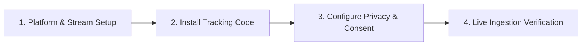

# ONBOARDING.md — Setup & Self-Hosting Guide

This document provides a complete, product-level onboarding guide for developers, system administrators, and platform users setting up **Open Source Google Tag Manager (GTM)** and **Google Analytics 4 (GA4)** across **Web, Android, iOS, and Server** environments.

---

## 1. Quickstart Matrix & Minimal-Step Self-Hosting

Deploy and self-host the entire platform with minimal steps using either Docker Compose or the local quickstart script:

### Option A: 1-Command Docker Compose (Production Ready)

```bash
# 1. Clone repository
git clone https://github.com/jimitchavda/gtm-ga4-open-source.git
cd gtm-ga4-open-source

# 2. Start full stack in background (Rust Engine + Next.js Gateway + SQLite Volume)
docker compose up -d
```
Access the platform at `http://localhost:3000`.

### Option B: 1-Command Native Quickstart (Dev / Evaluation)

```bash
# Automatically checks toolchain, installs dependencies, builds Rust engine & starts both servers
./quickstart.sh
```

---

## 2. Platform User Onboarding Flow

The platform includes an interactive, guided 4-step wizard accessible from the top navbar via the **"⚡ Setup Guide"** button:



---

## 3. Client Integration Guides

### 3.1 Website Integration (JavaScript / HTML)

Place the tracking snippet inside the `<head>` tag of every HTML page.

#### Recommended: First-Party Custom Snippet (Anti-Adblock Resilient)
```html
<!-- Open Source Tag Manager & Analytics -->
<script>
(function(w,d,s,l,i){w[l]=w[l]||[];w[l].push({'gtm.start':
new Date().getTime(),event:'gtm.js'});var f=d.getElementsByTagName(s)[0],
j=d.createElement(s),dl=l!='dataLayer'?'&l='+dl:'';j.async=true;j.src=
'/tracker.js?id='+i+dl;f.parentNode.insertBefore(j,f);
})(window,document,'script','dataLayer','GTM-OPENSOURCE');
</script>
<!-- End Open Source Tag Manager & Analytics -->
```

#### Noscript Fallback (Place immediately after the opening `<body>` tag)
```html
<noscript>
  <iframe src="/_trk/ns.html?id=GTM-OPENSOURCE"
  height="0" width="0" style="display:none;visibility:hidden"></iframe>
</noscript>
```

#### Direct GA4 Measurement Protocol (gtag.js style)
```html
<script async src="/tracker.js?id=G-TESTSTREAM"></script>
<script>
  window.dataLayer = window.dataLayer || [];
  function gtag(){dataLayer.push(arguments);}
  gtag('js', new Date());
  gtag('config', 'G-TESTSTREAM');
</script>
```

---

### 3.2 Android App Integration (Kotlin)

Integrate analytics directly into your Android application without external third-party SDK dependencies:

```kotlin
// OpenAnalytics.kt — Android Analytics Singleton
import java.net.HttpURLConnection
import java.net.URL
import java.util.UUID

object OpenAnalytics {
    private const val ENDPOINT = "https://your-analytics-domain.com/api/events/collect"
    private const val MEASUREMENT_ID = "G-TESTSTREAM"
    private val clientId = UUID.randomUUID().toString()

    fun logEvent(eventName: String, params: Map<String, String> = emptyMap()) {
        Thread {
            try {
                val query = StringBuilder("v=2")
                    .append("&tid=").append(MEASUREMENT_ID)
                    .append("&cid=").append(clientId)
                    .append("&en=").append(eventName)
                    .append("&_p=android")
                    .append("&aid=").append("com.example.app")

                params.forEach { (k, v) ->
                    query.append("&ep.").append(k).append("=").append(v)
                }

                val conn = URL("$ENDPOINT?$query").openConnection() as HttpURLConnection
                conn.requestMethod = "POST"
                conn.connectTimeout = 3000
                conn.responseCode // Emits hit (204 No Content)
            } catch (e: Exception) {
                e.printStackTrace()
            }
        }.start()
    }
}
```

**Usage in Activity / ViewModel**:
```kotlin
// Log app launch
OpenAnalytics.logEvent("app_open")

// Log ecommerce conversion
OpenAnalytics.logEvent("purchase", mapOf(
    "currency" to "USD",
    "value" to "99.00",
    "transaction_id" to "T_1001"
))
```

---

### 3.3 iOS App Integration (Swift)

Integrate analytics directly into your iOS project using standard Swift `URLSession`:

```swift
// OpenAnalytics.swift — iOS Analytics Singleton
import Foundation

class OpenAnalytics {
    static let shared = OpenAnalytics()
    private let endpoint = "https://your-analytics-domain.com/api/events/collect"
    private let measurementId = "G-TESTSTREAM"
    private let clientId = UUID().uuidString

    func logEvent(name: String, parameters: [String: String] = [:]) {
        var components = URLComponents(string: endpoint)!
        var items = [
            URLQueryItem(name: "v", value: "2"),
            URLQueryItem(name: "tid", value: measurementId),
            URLQueryItem(name: "cid", value: clientId),
            URLQueryItem(name: "en", value: name),
            URLQueryItem(name: "_p", value: "ios"),
            URLQueryItem(name: "bundle_id", value: "com.example.app")
        ]
        parameters.forEach { items.append(URLQueryItem(name: "ep.\($0.key)", value: $0.value)) }
        components.queryItems = items

        var request = URLRequest(url: components.url!)
        request.httpMethod = "POST"
        URLSession.shared.dataTask(with: request).resume()
    }
}
```

**Usage in SwiftUI / UIKit**:
```swift
// In onAppear or AppDelegate
OpenAnalytics.shared.logEvent(name: "app_open")

// Log conversion
OpenAnalytics.shared.logEvent(name: "purchase", parameters: [
    "currency": "USD",
    "value": "149.00"
])
```

---

### 3.4 Server-Side & Measurement Protocol Batch Ingestion

For backend microservices, payments, and offline CRM imports, dispatch batches to `/api/events/batch`:

```bash
curl -X POST "https://your-analytics-domain.com/api/events/batch?measurement_id=G-TESTSTREAM" \
  -H "Content-Type: application/json" \
  -d '{
    "client_id": "srv_client_100",
    "events": [
      {
        "name": "subscription_renewed",
        "params": {
          "currency": "USD",
          "value": 29.00
        }
      }
    ]
  }'
```

---

## 4. Live Verification & Testing

Verify that your tracking signal is arriving in real-time:

1. Click **"⚡ Setup Guide"** in the top navigation bar.
2. Select your platform (**Web**, **Android**, **iOS**, or **Server**).
3. Navigate to **Step 4: Live Verification** and click **"Send Test Ping"**.
4. Confirm:
   - Status code: `HTTP 204 No Content`
   - Ingestion latency: `< 15ms`
   - Active users incremented in **Analytics (GA4) > Realtime**.

---

## 5. Automated Verification Checklist

```bash
# Run all quality checks before production release
bun test && bun run lint && bun run typecheck && bun run verify:lines && cargo test --manifest-path crates/engine/Cargo.toml
```
