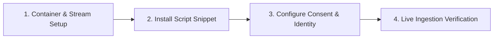

# ONBOARDING.md — Complete Setup & Onboarding Guide

This document provides a comprehensive, product-level onboarding guide for developers, system administrators, and platform users setting up **Open Source Google Tag Manager (GTM)** and **Google Analytics 4 (GA4)**.

---

## 1. Quickstart Onboarding Matrix

| Persona | Objective | Key Steps |
| :--- | :--- | :--- |
| **Developer / Admin** | Host and run the platform locally or on a server | Install Bun & Rust, configure `DATABASE_URL`, run `cargo run` and `bun run dev` |
| **GTM User** | Manage tags, triggers, variables, and deploy to sites | Create Container, embed `<script src="/tracker.js">`, configure tags, publish |
| **GA4 User** | Collect web analytics, measure conversions, view funnels | Create Data Stream, configure Measurement ID, verify live event ingestion |

---

## 2. Developer & Infrastructure Setup

### Prerequisites
- **Bun** (v1.4.0+): [https://bun.sh](https://bun.sh)
- **Rust & Cargo** (v1.80+): [https://rustup.rs](https://rustup.rs)
- (Optional) **PostgreSQL** (v14+) or **MySQL** (v8+) if not using SQLite.

### Step-by-Step Installation

```bash
# 1. Clone the repository
git clone https://github.com/your-org/gtm-ga4-open-source.git
cd gtm-ga4-open-source

# 2. Install frontend dependencies
bun install

# 3. Configure environment variables (optional, defaults provided)
cp .env.example .env 2>/dev/null || cat << 'EOF' > .env
PORT=3000
RUST_ENGINE_URL=http://localhost:8080
DATABASE_URL=sqlite://analytics.db?mode=rwc
EOF

# 4. Start the Rust Analytics Core Engine (:8080)
cargo run --manifest-path crates/engine/Cargo.toml

# 5. In a second terminal, start the Next.js Frontend (:3000)
bun run dev
```

Visit `http://localhost:3000` to access the unified platform dashboard.

---

## 3. Platform User Onboarding (Step-by-Step)

The platform provides a guided 4-step onboarding wizard accessible directly from the dashboard header via the **"⚡ Setup Guide"** button.



---

### Step 1: Container & Stream Setup

1. **Tag Manager Container**:
   - Assign a Container ID (default: `GTM-OPENSOURCE`).
   - Choose target environment: **Web** (client-side DOM tracking) or **Server** (first-party proxy container).
2. **Analytics Data Stream**:
   - Assign a Measurement ID (default: `G-TESTSTREAM`).
   - Define Stream Name (e.g., `Production Web Store`) and Stream URL (`https://yourdomain.com`).
   - Enhanced measurement is enabled by default (Page views, Scrolls, Outbound clicks, Site search, Video engagement, File downloads).

---

### Step 2: Install Tracking Snippet on Your Website

Place the tracking snippet inside the `<head>` tag of every page on your website.

#### Recommended: First-Party Custom Snippet (Anti-Adblock Resilient)
```html
<!-- Open Source Tag Manager & Analytics -->
<script>
(function(w,d,s,l,i){w[l]=w[l]||[];w[l].push({'gtm.start':
new Date().getTime(),event:'gtm.js'});var f=d.getElementsByTagName(s)[0],
j=d.createElement(s),dl=l!='dataLayer'?'&l='+dl:'';j.async=true;j.src=
'/tracker.js?id='+i+dl;f.parentNode.insertBefore(j,f);
})(window,document,'script','dataLayer','GTM-OPENSOURCE');
</script>
<!-- End Open Source Tag Manager & Analytics -->
```

#### Noscript Fallback (Place immediately after the opening `<body>` tag)
```html
<!-- Open Source Tag Manager (noscript) -->
<noscript>
  <iframe src="/_trk/ns.html?id=GTM-OPENSOURCE"
  height="0" width="0" style="display:none;visibility:hidden"></iframe>
</noscript>
<!-- End Open Source Tag Manager (noscript) -->
```

#### Alternative: Direct GA4 Measurement Protocol (gtag.js style)
```html
<script async src="/tracker.js?id=G-TESTSTREAM"></script>
<script>
  window.dataLayer = window.dataLayer || [];
  function gtag(){dataLayer.push(arguments);}
  gtag('js', new Date());
  gtag('config', 'G-TESTSTREAM');
</script>
```

> [!TIP]
> **Why `/tracker.js` instead of `googletagmanager.com`?**
> Standard ad-blockers and privacy extensions block domain names containing `google-analytics.com` and `googletagmanager.com`. Serving `/tracker.js` directly from your own domain makes your tracking completely first-party, resilient, and compliant with Safari ITP.

---

### Step 3: Configure Consent Mode v2 & Reporting Identity

1. **Consent Mode v2 Defaults**:
   - Set initial consent state before banner interaction:
     - `analytics_storage`: `granted` or `denied`
     - `ad_storage`: `granted` or `denied`
     - `ad_user_data`: `granted` or `denied`
     - `ad_personalization`: `granted` or `denied`
   - When denied, the platform automatically strips cookies and transmits cookieless pings encoded with `gcs` (e.g. `G100`).
2. **Reporting Identity Mode**:
   - **Blended (Recommended)**: Evaluates User ID, Device ID (FPID/Cookie), and AI-modeled behavior when consent is denied.
   - **Observed**: Uses User ID first, falling back to Device ID.
   - **Device-Based**: Uses only client-side Device ID (FPID/Cookie), ignoring User ID.

---

### Step 4: Live Verification & Testing

Once your tracking snippet is installed, verify live signal ingestion:

1. Open the **Setup Guide** modal or go to **Analytics (GA4) > Realtime**.
2. Click **"Send Verification Ping"** to emit a synthetic event payload to `/api/events/collect`.
3. Verify that the **Signal Ingestion Status** transitions from *Waiting for Signal* to **Active (Signal Received)**.
4. Confirm the incoming hit appears in the **Live Event Stream** with:
   - Event Name: `page_view`
   - Client ID: `test_client_...`
   - Status: HTTP 204 No Content
   - Ingestion Latency: `< 15ms`

---

## 4. Verification & Testing Checklist

Run all automated quality suites to verify system integrity before deploying to production:

```bash
# 1. Run all 50+ TypeScript frontend integration tests
bun test

# 2. Run all 40+ Rust backend integration tests
cargo test --manifest-path crates/engine/Cargo.toml

# 3. Check for Biome lint errors
bun run lint

# 4. Check strict TypeScript type safety
bun run typecheck

# 5. Verify file length invariants (< 200 lines per file)
bun run verify:lines
```
