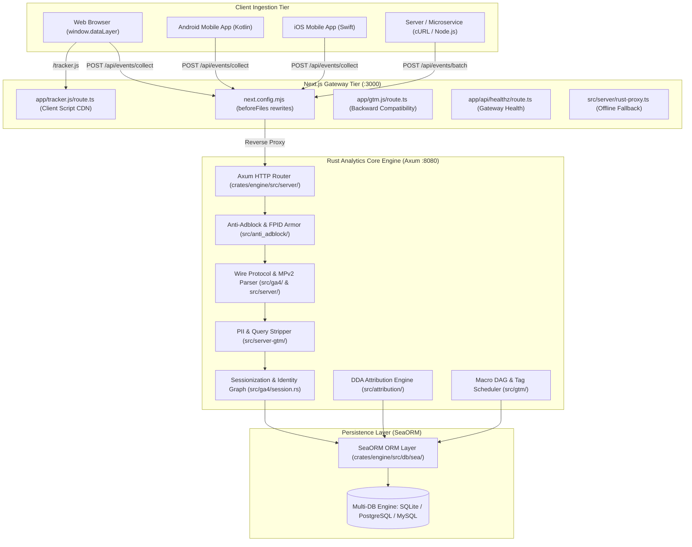
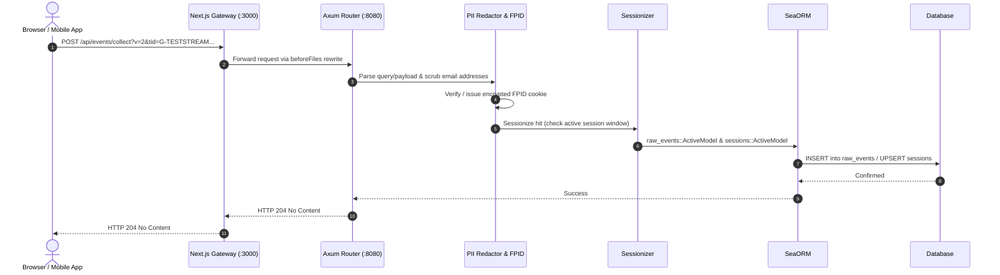

# System Architecture Specification for Agents

This document provides the definitive architectural blueprint of the **Open Source Analytics Kit (GTM & GA4 Full Parity)**, detailing tier interactions, threading models, data flows, and sub-engine responsibilities.

---

## 1. Complete System Topology

---

## 2. Gateway Tier: Next.js Presentation & Proxying

- **Strict Separation**: The Next.js layer executes zero database operations. It renders the Tailwind CSS single-page dashboards, serves the tracking script `/tracker.js`, and rewrites API traffic to the Rust engine.
- **Rewrites Map in `next.config.mjs`**:
  - `/api/events/:path*` -> `${RUST_ENGINE_URL}/api/v1/events/:path*`
  - `/api/analytics/:path*` -> `${RUST_ENGINE_URL}/api/v1/analytics/:path*`
  - `/api/tag-manager/:path*` -> `${RUST_ENGINE_URL}/api/v1/tag-manager/:path*`
  - `/api/admin/:path*` -> `${RUST_ENGINE_URL}/api/v1/admin/:path*`
  - `/_trk/:path*` -> `${RUST_ENGINE_URL}/_trk/:path*`
- **Offline Fallback Architecture (`src/server/rust-proxy.ts`)**:
  - During development or automated Bun unit tests where the Rust engine background process might not be running on port 8080, `rust-proxy.ts` detects connection timeouts and falls back seamlessly to `offline-fallback.ts` and `mp-fallback.ts`.
  - Guarantees instant, zero-flake CI test execution.

---

## 3. Rust Engine Tier (`crates/engine/`)

The core engine is built in Rust using **Axum**, **Tokio**, and **SeaORM** for high-throughput, low-latency concurrent processing.

### Subsystem Breakdown:
1. **`anti_adblock/`**:
   - `path_obfuscator.rs`: Generates pseudo-randomized endpoints with SHA-256 HMAC tokens.
   - `cookie_armor.rs`: Issues AES-256-GCM encrypted `HttpOnly` First-Party Device IDs (`FPID`).
   - `transport.rs`: Handles fallback beaconing and synthetic header normalization.
2. **`attribution/`**:
   - `markov.rs`: Computes cross-channel Markov Chain Removal Effects transition matrices across conversion journeys.
   - `shapley.rs`: Evaluates cooperative game theory Shapley value marginal contributions across marketing touchpoints.
3. **`ga4/`**:
   - `session.rs`: Evaluates 30-minute inactivity timeouts, midnight boundary splitting, and engagement qualification.
   - `identity.rs`: Implements the 3-tiered reporting identity resolution (Blended, Observed, Device-Based).
   - `custom_definitions.rs`: Quota enforcement (Free vs 360) and formula engine for calculated metrics.
4. **`gtm/`**:
   - `datalayer.rs`: DataLayer deep-merge v2 algorithm with array overwrite semantics.
   - `macro_dag.rs`: Topologically sorts variable dependencies, detects circular cycles, and memoizes values per event.
   - `triggers.rs`: Evaluates 11 predicate operators and Trigger Groups.
   - `scheduler.rs`: Tag scheduling, priority ordering, and Setup/Primary/Teardown sequencing.
5. **`server/`**:
   - `routes.rs`: Axum router composition and CORS headers.
   - `routes_events.rs`: Ingestion endpoints (`/api/v1/events/collect`, `/batch`, `/validate`, `/_trk/*`).
   - `routes_analytics.rs`: Reporting APIs (`reports/standard`, `realtime`, `attribution`, `funnel`).
   - `routes_tagmanager.rs`: Entity CRUD and workspace version publishing.

---

## 4. End-to-End Event Ingestion Sequence

