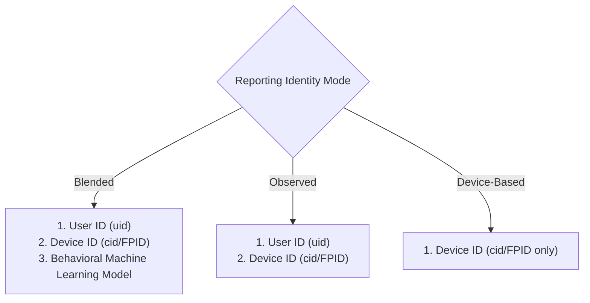

# Google Analytics 4 (GA4) Core Engine

This document details the internal architecture, mathematical algorithms, sessionization rules, and attribution models of the Google Analytics 4 engine implemented across `src/ga4/`, `crates/engine/src/ga4/`, and `crates/engine/src/attribution/`.

---

## 1. Event-Driven Data Model & Architecture

GA4 eliminates Universal Analytics' legacy "hit/pageview/session" silos in favor of a unified **Event-Driven Architecture**:

- Every user touchpoint is an **Event** accompanied by arbitrary key-value **Event Parameters** (`ep.*`) and **User Properties** (`up.*`).
- **Standard Automatic Events**: `page_view`, `first_visit`, `session_start`, `user_engagement`.
- **Enhanced Measurement**: Automatic client-side capture of `scroll` (90% threshold), `click` (outbound links), `view_search_results` (query parameter extraction), and `file_download`.

---

## 2. Sessionization Engine

Implemented in `src/ga4/session.ts` and `crates/engine/src/ga4/session.rs`.

### Session Boundary Invariants:
1. **30-Minute Inactivity Cutoff**: A new session is automatically initialized if consecutive hits from the same `client_id` exceed 30 minutes (1,800,000 ms) without activity.
2. **Midnight Cutoff**: If a session spans across 12:00:00 AM in the property's configured reporting timezone, the session splits automatically at midnight into two separate sessions.
3. **Engagement Qualification**:
   - A session is marked as `is_engaged = true` if it satisfies **at least one** of these criteria:
     - User spends **> 10 seconds** in active foreground engagement.
     - User triggers **2 or more distinct `page_view` or `screen_view` events**.
     - User triggers **1 or more conversion/key events** (e.g. `purchase`).
4. **Metrics**:
   - $\text{Engagement Rate} = \frac{\text{Engaged Sessions}}{\text{Total Sessions}}$
   - $\text{Bounce Rate} = 1.0 - \text{Engagement Rate}$

---

## 3. Reporting Identity Graph

Implemented in `src/ga4/identity.ts` and `crates/engine/src/ga4/identity.rs`.

The engine evaluates incoming events across 3 configurable reporting identity tiers:

- **Blended (Default & Recommended)**: Stitches user journeys using authenticated `uid` first. When missing or when consent is denied, it relies on Device ID and AI behavioral modeling to bridge gaps.
- **Observed**: Strict evaluation of `uid` and Device ID without modeling.
- **Device-Based**: Ignores authenticated User IDs, using only local device cookies/FPIDs.

---

## 4. Consent Mode v2 & Cookieless Signals

### The 7 Consent Types:
`ad_storage`, `analytics_storage`, `ad_user_data`, `ad_personalization`, `functionality_storage`, `personalization_storage`, `security_storage`.

### Wire Protocol Encoding:
- **`gcs` String**: 4-character format: `G1` + `ad_storage` (1/0) + `analytics_storage` (1/0).
  - `G111`: Both Granted.
  - `G100`: Both Denied (Cookieless ping).
  - `G101`: Ads Denied, Analytics Granted.
- **`gcd` String**: Encodes source (default vs update) and granular state across all 7 signals (e.g. `13r3r3r5r5l1`).
- **Cookieless Ping Handling**: When `analytics_storage` is `denied`, persistent cookies and `cid` are stripped. Hits are marked as cookieless pings and utilized solely for aggregate behavioral modeling.

---

## 5. Algorithmic Attribution Engine (DDA)

Implemented in `src/ga4/attribution.ts` and `crates/engine/src/attribution/`.

### 1. Cross-Channel Last Click (Excluding Direct)
- Traverses the user journey in reverse chronological order.
- Attributes 100% of conversion credit to the latest non-direct channel (Paid Search, Organic, Email, Social).
- Falls back to Direct only if no other touchpoint exists.

### 2. Markov Chain Removal Effects
- Models all customer conversion paths as a state transition probability matrix $M$.
- Calculates overall baseline conversion rate $P(\text{Conversion})$.
- Computes the **Removal Effect** for each channel $C_i$ by removing state $C_i$ from the graph and recalculating $P(\text{Conversion} \mid \text{no } C_i)$:
  $$\text{Removal Effect}(C_i) = 1 - \frac{P(\text{Conversion} \mid \text{no } C_i)}{P(\text{Conversion})}$$
- Channel attribution weights are normalized proportionally across removal effect quotients.

### 3. Shapley Value (Cooperative Game Theory)
- Treats marketing channels as players in a cooperative game.
- Computes the marginal contribution of channel $i$ across all possible channel subsets $S \subseteq N \setminus \{i\}$:
  $$\phi_i(v) = \sum_{S \subseteq N \setminus \{i\}} \frac{|S|!(|N| - |S| - 1)!}{|N|!} (v(S \cup \{i\}) - v(S))$$
- Guarantees fair, mathematically axiom-compliant budget attribution.

---

## 6. High-Scale Ingestion & The 24–48 Hour Processing Latency

### 6.1 Dual-Path Ingestion Architecture (Lambda / Kappa Pattern)
Google Analytics 4 ingests tens of billions of events per day using a bifurcated pipeline:
1. **Stream Path (Realtime Report — < 1 second latency)**:
   - Hit arrives at Edge Anycast Google Front End (GFE) -> pub/sub stream -> in-memory streaming processor (Cloud Dataflow / Bigtable).
   - Only counts raw event hits and active client IDs for the trailing 30-minute window.
   - Performs **zero** heavy computation (no multi-touch attribution, no cross-device identity stitching, no behavioral modeling).
2. **Batch / Analytics Lake Path (Standard Reports — 12 to 48 hours latency)**:
   - Raw hits are buffered into distributed columnar analytical storage (Colossus / BigQuery Capacitor).
   - Periodic batch jobs run heavy algorithmic transformations across 24-hour windows.

### 6.2 The 6 Architectural Reasons for the 12–48 Hour Reporting Lag
1. **Late-Arriving Data Window (Up to 72 Hours)**:
   - Mobile apps (iOS/Android) cache hits offline when devices lose network connectivity and flush them hours or days later. Measurement Protocol allows late hits up to 72 hours in the past. GA4 holds reporting consolidation to avoid retroactive metric divergence.
2. **Sessionization & Midnight Timezone Re-Aggregation**:
   - Sessions are subject to 30-minute inactivity timeouts and midnight boundary splitting based on the property's local timezone. A session started at 11:45 PM cannot be finalized until all potential hits across the midnight threshold have arrived.
3. **Cross-Device Identity Stitching (Blended Graph)**:
   - Stitching a user's multi-device path (phone -> laptop -> tablet) requires retroactively scanning past sessions once a user signs in (`uid` or Google Signals match). GA4 re-attributes historical anonymous hits to the unified user profile during daily batch cycles.
4. **Data-Driven Attribution (DDA) Journey Computation**:
   - DDA computes Shapley values and Markov removal effects across multi-channel paths with up to **90-day lookback windows**. Calculating transition matrices cannot be done in real time per hit; it requires batch graph traversal over completed journeys.
5. **Machine Learning Behavioral & Conversion Modeling**:
   - For users denying consent under Consent Mode v2 (`gcs=G100`), GA4 trains machine learning models on consented user cohorts to estimate unconsented traffic and conversion volumes. Model retraining and batch inference run on scheduled daily pipelines.
6. **Pre-Aggregation Rollups, HyperLogLog & Privacy Thresholding**:
   - Standard reports query pre-aggregated summary tables rather than scanning billions of raw rows at query time. During rollup creation, GA4 applies HyperLogLog (HLL++) cardinality estimation and data thresholding to protect user anonymity when audience counts are small.

