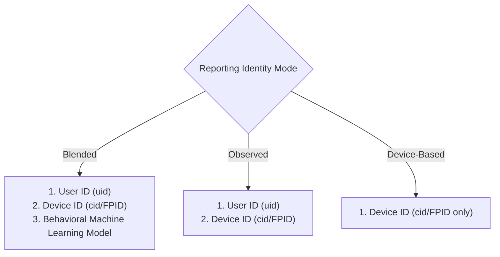

# Google Analytics 4 (GA4) Core Engine

This document details the internal architecture, mathematical algorithms, sessionization rules, and attribution models of the Google Analytics 4 engine implemented across `src/ga4/`, `crates/engine/src/ga4/`, and `crates/engine/src/attribution/`.

---

## 1. Event-Driven Data Model & Architecture

GA4 eliminates Universal Analytics' legacy "hit/pageview/session" silos in favor of a unified **Event-Driven Architecture**:

- Every user touchpoint is an **Event** accompanied by arbitrary key-value **Event Parameters** (`ep.*`) and **User Properties** (`up.*`).
- **Standard Automatic Events**: `page_view`, `first_visit`, `session_start`, `user_engagement`.
- **Enhanced Measurement**: Automatic client-side capture of `scroll` (90% threshold), `click` (outbound links), `view_search_results` (query parameter extraction), and `file_download`.

---

## 2. Sessionization Engine

Implemented in `src/ga4/session.ts` and `crates/engine/src/ga4/session.rs`.

### Session Boundary Invariants:
1. **30-Minute Inactivity Cutoff**: A new session is automatically initialized if consecutive hits from the same `client_id` exceed 30 minutes (1,800,000 ms) without activity.
2. **Midnight Cutoff**: If a session spans across 12:00:00 AM in the property's configured reporting timezone, the session splits automatically at midnight into two separate sessions.
3. **Engagement Qualification**:
   - A session is marked as `is_engaged = true` if it satisfies **at least one** of these criteria:
     - User spends **> 10 seconds** in active foreground engagement.
     - User triggers **2 or more distinct `page_view` or `screen_view` events**.
     - User triggers **1 or more conversion/key events** (e.g. `purchase`).
4. **Metrics**:
   - $\text{Engagement Rate} = \frac{\text{Engaged Sessions}}{\text{Total Sessions}}$
   - $\text{Bounce Rate} = 1.0 - \text{Engagement Rate}$

---

## 3. Reporting Identity Graph

Implemented in `src/ga4/identity.ts` and `crates/engine/src/ga4/identity.rs`.

The engine evaluates incoming events across 3 configurable reporting identity tiers:

- **Blended (Default & Recommended)**: Stitches user journeys using authenticated `uid` first. When missing or when consent is denied, it relies on Device ID and AI behavioral modeling to bridge gaps.
- **Observed**: Strict evaluation of `uid` and Device ID without modeling.
- **Device-Based**: Ignores authenticated User IDs, using only local device cookies/FPIDs.

---

## 4. Consent Mode v2 & Cookieless Signals

### The 7 Consent Types:
`ad_storage`, `analytics_storage`, `ad_user_data`, `ad_personalization`, `functionality_storage`, `personalization_storage`, `security_storage`.

### Wire Protocol Encoding:
- **`gcs` String**: 4-character format: `G1` + `ad_storage` (1/0) + `analytics_storage` (1/0).
  - `G111`: Both Granted.
  - `G100`: Both Denied (Cookieless ping).
  - `G101`: Ads Denied, Analytics Granted.
- **`gcd` String**: Encodes source (default vs update) and granular state across all 7 signals (e.g. `13r3r3r5r5l1`).
- **Cookieless Ping Handling**: When `analytics_storage` is `denied`, persistent cookies and `cid` are stripped. Hits are marked as cookieless pings and utilized solely for aggregate behavioral modeling.

---

## 5. Algorithmic Attribution Engine (DDA)

Implemented in `src/ga4/attribution.ts` and `crates/engine/src/attribution/`.

### 1. Cross-Channel Last Click (Excluding Direct)
- Traverses the user journey in reverse chronological order.
- Attributes 100% of conversion credit to the latest non-direct channel (Paid Search, Organic, Email, Social).
- Falls back to Direct only if no other touchpoint exists.

### 2. Markov Chain Removal Effects
- Models all customer conversion paths as a state transition probability matrix $M$.
- Calculates overall baseline conversion rate $P(\text{Conversion})$.
- Computes the **Removal Effect** for each channel $C_i$ by removing state $C_i$ from the graph and recalculating $P(\text{Conversion} \mid \text{no } C_i)$:
  $$\text{Removal Effect}(C_i) = 1 - \frac{P(\text{Conversion} \mid \text{no } C_i)}{P(\text{Conversion})}$$
- Channel attribution weights are normalized proportionally across removal effect quotients.

### 3. Shapley Value (Cooperative Game Theory)
- Treats marketing channels as players in a cooperative game.
- Computes the marginal contribution of channel $i$ across all possible channel subsets $S \subseteq N \setminus \{i\}$:
  $$\phi_i(v) = \sum_{S \subseteq N \setminus \{i\}} \frac{|S|!(|N| - |S| - 1)!}{|N|!} (v(S \cup \{i\}) - v(S))$$
- Guarantees fair, mathematically axiom-compliant budget attribution.
