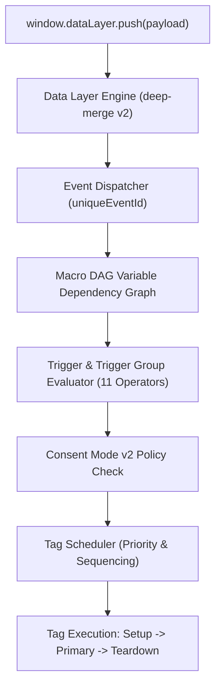

# Google Tag Manager (GTM) Core Engine

This document details the internal architecture, algorithms, execution semantics, and enterprise capabilities of the Google Tag Manager engine implemented across `src/gtm/` and `crates/engine/src/gtm/`.

---

## 1. Engine Architecture & Subsystems

---

## 2. Data Layer Engine & Deep-Merge v2

The Data Layer serves as the asynchronous communication queue between client applications and the tag management container.

### Key Specifications:
1. **Array Monkey-Patching**:
   - `window.dataLayer = window.dataLayer || []`
   - Overrides `dataLayer.push` to process incoming objects synchronously in FIFO order while preserving array iteration capabilities.
2. **Deep-Merge v2 Semantics**:
   - Properties are recursively merged into the container's global abstract data model.
   - **Array Overwrite Rule**: Arrays in new payloads completely overwrite existing arrays at the same key path rather than appending or merging items.
   - **Command Execution**: If a function is passed to `dataLayer.push(fn)`, it executes immediately with the container context as `this`.
3. **Monotonic `uniqueEventId`**:
   - Every event emitted via `dataLayer.push` increments an internal integer counter, guaranteeing absolute ordering across asynchronous tag lifecycles.

---

## 3. Macro DAG (Directed Acyclic Graph)

Variables in GTM can reference other variables (e.g. Variable A uses Variable B which uses Variable C).

### Dependency Resolution:
- **Topological Sorting**: Evaluates variable nodes in strict dependency order.
- **Cycle Detection**: Detects circular loops (e.g. `A -> B -> A`) and returns a graceful undefined fallback rather than overflowing the call stack.
- **Per-Event Memoization**: Caches evaluated variable results for the duration of a single `uniqueEventId` processing cycle to eliminate redundant calculations.

---

## 4. Trigger & Predicate Evaluation

Triggers listen for events and evaluate predicates against runtime variables.

### The 11 Core Predicate Operators:
1. `equals` / `does_not_equal`
2. `contains` / `does_not_contain`
3. `starts_with` / `does_not_start_with`
4. `ends_with` / `does_not_end_with`
5. `matches_regex` / `does_not_match_regex` (supports full regex patterns)
6. `matches_css_selector` (DOM element matching)
7. `less_than` / `less_than_or_equal`
8. `greater_than` / `greater_than_or_equal`

### Trigger Groups:
- A Trigger Group contains 2 or more triggers. It only evaluates to `true` when **all** member triggers have been satisfied within the current visitor session lifecycle.

---

## 5. Tag Scheduler & Sequencing

When one or more triggers evaluate to `true`, matching tags are scheduled for execution:

1. **Tag Priority**:
   - Tags are sorted by numerical `priority` descending (e.g., priority `100` executes before priority `10`).
2. **Tag Sequencing**:
   - **Setup Tag**: Executes first and must complete successfully before the primary tag fires.
   - **Primary Tag**: Main tracking or pixel dispatch.
   - **Teardown Tag**: Executes after the primary tag concludes.
3. **Firing Frequency Capping**:
   - `once_per_page`: Fires at most once during the current HTML page document lifecycle.
   - `once_per_event`: Fires on every matching event.
   - `unlimited`: No firing constraints.

---

## 6. GTM 360 Enterprise Features

- **Container Zones**: Enables parent enterprise containers to establish child container boundaries with explicit allowlists/blocklists for tag types (e.g., allow GA4, block raw custom HTML).
- **Multi-Stage Approvals**: Enforces a formal governance workflow requiring review, inline comment threads, and multi-tier sign-off before publishing container versions to production.
